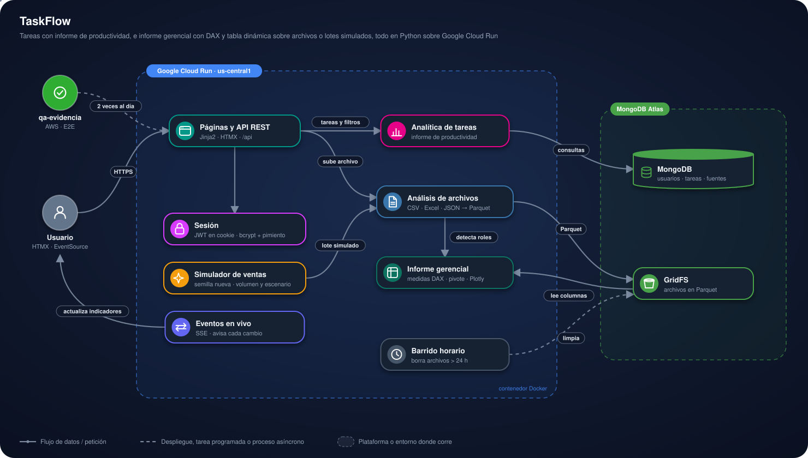

# Gestor de tareas (TaskFlow)

<p>
  <a href="https://taskflow-812302804238.us-east4.run.app/"></a>
  <a href="https://frontend-nine-topaz-99.vercel.app"></a>
  <a href="https://d4i3vsgw7xwmh.cloudfront.net"></a>
</p>


> 📘 **[Manual de usuario](docs/MANUAL.md)**: cómo usar cada pantalla, paso a paso y con imágenes.

## Contenido

1. [Presentación](#1-presentación)
2. [Funcionalidades](#2-funcionalidades)
3. [Arquitectura y decisiones de diseño](#3-arquitectura-y-decisiones-de-diseño)
4. [Estructura del proyecto](#4-estructura-del-proyecto)
5. [Instalación para pruebas](#5-instalación-para-pruebas)
6. [Autor y licencia](#6-autor-y-licencia)

---

## 1. Presentación

Aplicación web de gestión de tareas con un módulo de análisis de datos, construida enteramente en
Python: FastAPI en el servidor, Jinja2 con HTMX en la interfaz y pandas para el análisis.

- **Qué hace:** una lista de tareas con fechas, prioridades y categorías, más un panel que muestra
  cómo vas: cuántas cumples, cuánto tardas en cerrarlas y cuáles están vencidas. Los números se
  actualizan solos, sin recargar.
- **Extra:** subes un CSV, Excel o JSON (o generas un lote de ventas simulado) y la app lo
  convierte en un **informe gerencial**: indicadores con variación, gráficos explicados, medidas
  DAX, tabla dinámica y la trazabilidad del origen de los datos.
- **Cómo probarlo:** entra a la [demo](https://taskflow-812302804238.us-east4.run.app/), crea una
  cuenta y agrega un par de tareas.

## 2. Funcionalidades

**Cuentas:** registro e ingreso con verificación en dos pasos obligatoria (app autenticadora o
código por correo) y recuperación de la contraseña y del autenticador por correo. Cada cuenta ve
únicamente lo suyo.

**Tareas:** crear, completar, filtrar, buscar y eliminar, con categorías, prioridades y fechas límite.

**Analítica de tareas:** cumplimiento, tiempo medio de cierre y tareas vencidas, con la variación de
las últimas 4 semanas frente a las 4 anteriores, hallazgos escritos, gráficos con guía de lectura y
filtros que recalculan sin recargar.

**Informe gerencial de archivos:**
- Carga de CSV, Excel y JSON, o un lote de ventas simulado con una semilla nueva cada vez.
- Detección automática de la fecha, la medida principal y las dimensiones.
- Resumen ejecutivo, medidas DAX con editor propio, tabla dinámica con exportación, explorador
  libre de gráficos, origen y calidad de los datos, descarga en CSV e impresión a PDF.

**Interfaz:** adaptable a celular, tablet y computador, tema claro y oscuro con paleta validada para
daltonismo, instalable como aplicación.

## 3. Arquitectura y decisiones de diseño

<p align="center">
  
</p>

| Capa | Tecnología |
|---|---|
| Servidor | FastAPI |
| Interfaz | Jinja2, HTMX, Tailwind CSS |
| Tiempo real | Server-Sent Events |
| Análisis | pandas, con Parquet como formato interno |
| Gráficos | Plotly, renderizado en el servidor |
| Medidas | Intérprete propio de un subconjunto de DAX sobre pandas |

- **Parquet como formato interno.** El archivo se lee una sola vez y se guarda convertido: cargar
  dos columnas cuesta milisegundos frente a releer el original en cada cambio de filtro.
- **La agregación se hace en pandas.** Permite series de tiempo (remuestreo semanal, medias móviles)
  con código mucho más claro que el equivalente en la base.
- **Las medidas se escriben en DAX y se evalúan con pandas.** La fórmula que se muestra es la que
  produce la cifra; cuando un desplazamiento de fechas cae fuera de los datos, la medida devuelve
  vacío en lugar de comparar contra un periodo a medias.
- **El mes de cierre es el último mes completo**, para no comparar un mes a medias con uno entero.
- **Datos simulados reproducibles:** cada lote guarda su semilla; con la misma semilla sale el mismo
  archivo.
- **Archivos temporales:** se borran al cerrar sesión y, si nadie pulsa "Salir", un barrido los
  elimina tras un tiempo sin uso.

## 4. Estructura del proyecto

```
backend/app/
├── main.py           Punto de entrada
├── routers/          Páginas web, módulo de datos y eventos en vivo
├── analitica.py      Cálculos sobre tareas con pandas
├── datos.py          Carga y perfilado de archivos
├── generador.py      Simulador de ventas con semilla y escenario
├── tablero.py        Informe gerencial: indicadores, gráficos y tabla dinámica
├── dax.py            Intérprete de medidas DAX
├── graficos.py       Paleta y construcción de gráficos
├── templates/        Plantillas Jinja2
└── static/           Estilos y scripts
tests/                Pruebas (pytest)
docs/                 Manual de usuario y diagramas
```

## 5. Instalación para pruebas

Requisitos: Python 3.12 o 3.13 y una base MongoDB propia.

```bash
cd backend
python -m venv .venv
.venv\Scripts\Activate.ps1        # Windows (en Linux o macOS: source .venv/bin/activate)
pip install -r requirements.txt
cp ../.env.example ../.env        # completa las variables que indica la plantilla
uvicorn app.main:app --reload
```

Pruebas: desde la raíz, `python -m pytest -q tests` (no usan servicios externos). Nunca subas tu
`.env` al repositorio.

## 6. Autor y licencia

**Luis F. A.** · [GitHub](https://github.com/lariasca1994) · [LinkedIn](https://linkedin.com/in/lfac1)

Contacto: Telegram [@lfac6](https://t.me/lfac6) · WhatsApp [@carraian160](https://wa.me/carraian160) ·
[ariascluisf@hotmail.com](mailto:ariascluisf@hotmail.com)

Licencia: MIT.
