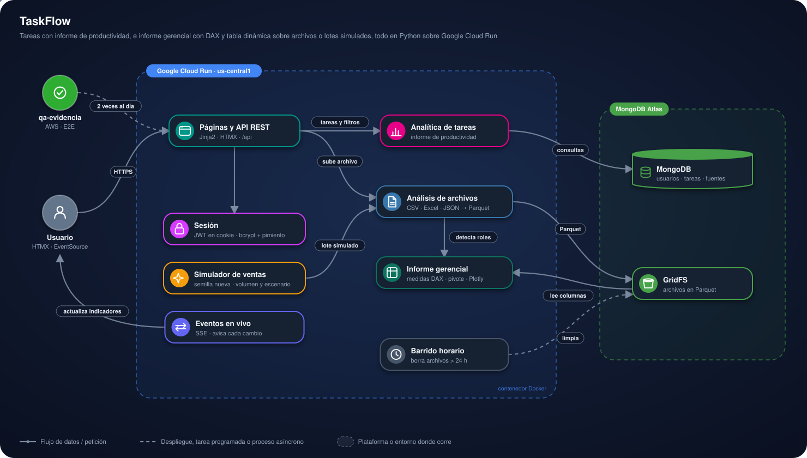

# TaskFlow

<p>
  <a href="https://taskflow-812302804238.us-east4.run.app/"></a>
  <a href="https://frontend-nine-topaz-99.vercel.app"></a>
  <a href="https://d4i3vsgw7xwmh.cloudfront.net"></a>
</p>


## Contenido

1. [Presentación](#1-presentación)
2. [Estructura del proyecto](#2-estructura-del-proyecto)
3. [Arquitectura](#3-arquitectura)
4. [Plataformas y su función](#4-plataformas-y-su-función)
5. [Cómo usar la plataforma](#5-cómo-usar-la-plataforma)
6. [Instalación para pruebas](#6-instalación-para-pruebas)
7. [Autor y licencia](#7-autor-y-licencia)

---

## 1. Presentación

Aplicación web de gestión de tareas personales con un módulo de análisis de
datos. Construida enteramente en Python: FastAPI en el servidor, Jinja2 con
HTMX en la interfaz, pandas para el análisis y MongoDB como única base de datos.

La interactividad la resuelve HTMX pidiendo fragmentos de HTML al servidor. El
JavaScript propio se limita a lo que no puede hacer el servidor: el canal de
eventos, el cambio de tema y, en el informe de datos, las pestañas, el clic
para filtrar y adaptar los gráficos al tema oscuro.

### En pocas palabras

- **Qué hace:** es una lista de tareas con fechas, prioridades y categorías, más
  un panel que muestra cómo vas: cuántas cumples, cuánto tardas en cerrarlas y
  cuáles están vencidas. Los números se actualizan solos, sin recargar.
- **Extra:** subes un CSV, Excel o JSON —o generas un lote de ventas
  simulado— y la app lo convierte en un **informe gerencial**: indicadores con
  variación, gráficos explicados, medidas DAX, tabla dinámica y la trazabilidad
  del origen de los datos.
- **Cómo probarlo:** entra a la [demo](https://taskflow-812302804238.us-east4.run.app/),
  crea una cuenta y agrega un par de tareas. Para correrlo en tu equipo, ve a
  [Instalación para pruebas](#6-instalación-para-pruebas).

### Demo en vivo

**Aplicación:** [abrir la demo en vivo](https://taskflow-812302804238.us-east4.run.app/)

### Funcionalidades

**Cuentas**
- Registro e ingreso con contraseñas hasheadas
- Verificación en dos pasos obligatoria: app autenticadora o código por correo, a elección; el otro
  método se puede agregar desde **Seguridad**
- Sesión con inactividad deslizante de 30 minutos y duración máxima de 12 horas
- Cada usuario ve únicamente lo suyo: la pertenencia se verifica en la consulta

**Tareas**
- Crear, completar, filtrar, buscar y eliminar
- Categorías, prioridades y fechas límite

**Analítica de tareas: informe de productividad**
- Indicadores de cumplimiento, tiempo medio de cierre y tareas vencidas, con la
  variación de las últimas 4 semanas frente a las 4 anteriores y minitendencia
- Tres hallazgos escritos (categoría dominante, la más atrasada, ritmo de cierre)
- Serie de creadas frente a completadas por semana completa, distribución por
  estado, estado por prioridad y categorías, con un color fijo por estado
- Guía de lectura y botón «¿Cómo leerlo?» en cada gráfico
- Filtros por rango de fechas, categoría y prioridad que recalculan sin recargar

**Análisis de archivos: informe gerencial**
- Carga de CSV, Excel y JSON, o **generación de un lote de ventas simulado**:
  cada lote usa una semilla nueva, así que cambian el volumen (de 500 a 20.000
  filas), el periodo, la tendencia, la temporada, la mezcla de regiones y
  canales y los eventos (promociones, desabastecimientos)
- Detección automática de la fecha, la medida principal y las dimensiones
- **Origen visible**: linaje de cinco pasos (fuente → lectura → almacén →
  modelo → informe), ficha de origen con la semilla y el escenario, y revisión
  de calidad (completitud, vacíos, duplicados, rol de cada columna)
- **Resumen ejecutivo**: indicadores con variación frente al mes anterior y
  minitendencia, tres hallazgos escritos, evolución mensual con promedio móvil
  y año anterior, participación, quién crece y quién cae, mezcla mensual y mapa
  de calor
- **Medidas DAX**: catálogo de medidas escritas en DAX (mes anterior, año
  anterior, acumulado del año, promedio móvil…) evaluadas sobre el archivo, y
  un editor para escribir medidas propias con desglose por dimensión
- **Tabla dinámica**: filas, columnas, valor, función y «mostrar como %», con
  totales, escala de calor, consulta DAX equivalente y exportación a CSV
- **Pensado para leerse de un vistazo**: guía de lectura, botón «¿Cómo leerlo?»
  en cada gráfico, ayuda en cada indicador y clic en un gráfico para filtrar
  todo el informe
- Segmentadores por fecha y categoría que aplican a todas las pestañas
- Explorador libre con siete tipos de gráfico, vista previa, descarga del CSV
  completo e impresión a PDF
- Tema claro y oscuro con la paleta del proyecto, validada para daltonismo

**Tiempo real**
- Los indicadores se actualizan solos cuando cambia algo, sin recargar

### Stack

| Capa | Tecnología |
|---|---|
| Servidor y API | FastAPI, Uvicorn |
| Interfaz | Jinja2, HTMX, Tailwind CSS |
| Tiempo real | Server-Sent Events |
| Base de datos | MongoDB, con GridFS para archivos |
| Análisis | pandas |
| Formato interno | Parquet |
| Gráficos | Plotly, renderizado en el servidor |
| Medidas | Intérprete propio de un subconjunto de DAX sobre pandas |
| Sesiones | JWT en cookie httponly |
| Contraseñas | Hash con sal y una clave adicional |

---

## 2. Estructura del proyecto

```
backend/
├── requirements.txt
└── app/
    ├── main.py              Punto de entrada, middleware y barrido periódico
    ├── config.py            Carga del .env y límites
    ├── database.py          Conexión, índices y GridFS
    ├── security.py          Hasheo de contraseñas y sesiones
    ├── dependencias.py      Identificación del usuario
    ├── esquemas.py          Modelos de entrada y salida
    ├── repositorio.py       Acceso a datos de tareas
    ├── analitica.py         Cálculos sobre tareas con pandas
    ├── datos.py             Carga, perfilado y almacenamiento de archivos
    ├── generador.py         Simulador de ventas con semilla y escenario
    ├── tablero.py           Informe gerencial: modelo, indicadores, gráficos y pivote
    ├── dax.py               Intérprete de medidas DAX sobre pandas
    ├── graficos.py          Paleta y construcción de gráficos
    ├── eventos.py           Canal de eventos en vivo
    ├── comandos/            Generadores de tareas y de ventas de ejemplo
    ├── routers/
    │   ├── api.py           API REST
    │   ├── web.py           Páginas de tareas y analítica
    │   ├── datasets.py      Módulo de análisis de archivos
    │   └── eventos.py       Canal SSE
    ├── templates/           Plantillas Jinja2 (una por sección del informe)
    └── static/              Estilos (tablero.css para el informe) y scripts
```

---

## 3. Arquitectura

<p align="center">
  
</p>

- Una sola app FastAPI sirve las páginas Jinja2 + HTMX y la API REST,
  protegidas por una sesión JWT en cookie.
- La **analítica** se calcula con pandas y los gráficos se generan en el
  servidor con Plotly.
- Los archivos subidos se convierten a **Parquet** y se guardan en **GridFS**;
  un barrido horario borra los que llevan 24 horas sin uso.
- El **simulador de ventas** crea lotes con una semilla nueva (otro volumen y
  escenario) que entran por el mismo camino que un archivo subido.
- El **informe gerencial** lee del Parquet solo las columnas que necesita,
  detecta fecha, medida y dimensiones, y calcula las medidas DAX, la tabla
  dinámica y los gráficos.
- Los **eventos en vivo** (Server-Sent Events) avisan al navegador cuando
  cambia una tarea, para que los indicadores se actualicen solos.

### Decisiones de diseño

**Parquet como formato interno.** El archivo que sube el usuario se lee una sola
vez y se guarda convertido. Parquet es columnar y comprimido, así que cargar dos
columnas cuesta milisegundos frente a releer y reinterpretar el original en cada
cambio de filtro. Es lo que hace viable un explorador interactivo.

**Los archivos viven en GridFS**, no en disco. La aplicación no depende del
sistema de archivos local, así que funciona igual en un servicio con
almacenamiento efímero.

**La agregación se hace en pandas y no en la base.** El volumen por usuario es
reducido, y trabajar sobre un DataFrame permite operaciones de series de tiempo
—remuestreo semanal, medias— que en Mongo exigirían tuberías bastante más largas
y difíciles de leer.

**Los gráficos se renderizan en el servidor** y viajan como HTML. El navegador
solo los dibuja; en tema oscuro, un script cambia cada color por su par de la
paleta oscura, validada aparte sobre el fondo oscuro.

**Las medidas se escriben en DAX y se evalúan con pandas.** El catálogo del
informe está escrito en DAX, así que la fórmula que se muestra es la que produce
la cifra. Un parser propio interpreta el subconjunto que se usa en un informe
gerencial (agregaciones, `DIVIDE`, `CALCULATE` con filtros, `ALL` e inteligencia
de tiempo). Cuando un desplazamiento de fechas cae fuera de los datos, la medida
devuelve vacío, en lugar de comparar contra un periodo a medias.

**El mes de cierre es el último mes completo.** Si el archivo termina a mitad de
mes, comparar ese mes con el anterior haría parecer que las ventas se
desplomaron; los indicadores comparan el último mes completo y la tendencia
omite los meses parciales.

**Datos simulados reproducibles.** Cada lote guarda su semilla en la ficha de
origen: con la misma semilla se obtiene exactamente el mismo archivo.

**Server-Sent Events y no WebSockets.** El flujo va en un solo sentido y SSE
reconecta por su cuenta. Además, `EventSource` no admite cabeceras propias, de
modo que la autenticación viaja necesariamente en la cookie de sesión: es la
razón por la que la sesión se guarda así y no en almacenamiento del navegador.

**Doble caducidad de los archivos.** Se borran al cerrar sesión, pero casi nadie
pulsa "Salir": un barrido horario elimina los que lleven 24 horas sin uso, para
que nada quede huérfano.

### Seguridad

- **Bloqueo temporal** ante intentos fallidos repetidos de contraseña o de código.
- **Registro de eventos de seguridad:** ingresos, intentos fallidos, bloqueos y cambios de
  contraseña quedan registrados (nunca contraseñas ni códigos) y se depuran solos.
- **Al día en seguridad:** el runtime, el sistema y las dependencias se mantienen con los últimos
  parches y se revisan periódicamente.
#### Contraseñas

Se guardan solo como huella (hash de una sola vía) con sal y una clave adicional que vive
fuera de la base; las cuentas con un esquema anterior se actualizan solas en el siguiente
ingreso.

#### Resto

- Verificación en dos pasos obligatoria (TOTP o código por correo): la clave TOTP se guarda
  cifrada, los códigos no se reutilizan y el del correo se guarda solo como huella
- Sesión en una cookie que JavaScript no puede leer
- Vencimiento por inactividad y por tiempo máximo
- Pertenencia verificada en el filtro de la consulta, no en la vista
- Validación de archivos por extensión, tamaño y número de filas
- Formatos que ejecutan código al deserializar, como pickle, rechazados
- Cuota de archivos por cuenta
- Búsquedas con la entrada escapada antes de construir la expresión regular
- Las fórmulas DAX nunca pasan por `eval`: un parser propio solo ejecuta las
  funciones permitidas
- Los nombres que vienen del archivo se escapan antes de mezclarse con HTML
- Cabeceras `X-Content-Type-Options`, `X-Frame-Options` y `Referrer-Policy`

### Limitación conocida

El registro de suscriptores del canal de eventos vive en memoria del proceso.
Con un único proceso de Uvicorn funciona correctamente; con varios trabajadores,
un evento generado en uno no alcanzaría a los clientes conectados a otro. La
solución sería un intermediario como Redis, descartado para no añadir una
dependencia externa a un proyecto que debe levantarse con un solo comando.

---

## 4. Plataformas y su función

| Plataforma | Función en el proyecto |
|---|---|
|  | Corre la app FastAPI: páginas Jinja2 + HTMX, API REST y canal de eventos en vivo. |
|  | MongoDB Atlas guarda usuarios, tareas y archivos (estos últimos en GridFS). Es el único servicio externo: no requiere otra cuenta ni clave de API. |
|  | Prueba la demo automáticamente dos veces al día y publica la evidencia. |

---

## 5. Cómo usar la plataforma

### 5.1 Crear una cuenta

1. En la página de inicio, pulsa **Crear cuenta**.
2. Completa **Nombre**, **Correo electrónico** y **Contraseña**.
3. Pulsa **Crear cuenta** y elige tu verificación en dos pasos: **App autenticadora** (escanea el
   QR y escribe el primer código) o **Código por correo**.

### 5.2 Iniciar sesión

1. Pulsa **Ya tengo cuenta** o **Ingresar** en el menú.
2. Escribe **Correo electrónico** y **Contraseña** y pulsa **Ingresar**.
3. Escribe el código de 6 dígitos de tu app o de tu correo y pulsa **Verificar**. En **Seguridad**
   puedes agregar el otro método y elegir cuál se pide por defecto.
4. El menú superior muestra **Tareas**, **Analítica**, **Datos**, **API ↗** y
   **Salir**.

La sesión se cierra tras 30 minutos sin actividad y, en cualquier caso, a las 12
horas.

### 5.3 Gestionar tareas

1. En **Tareas**, escribe en **¿Qué necesitas hacer?** y, si quieres, completa:

   | Campo | Dato |
   |---|---|
   | Categoría | Texto libre para agrupar tareas |
   | Prioridad | Baja, media o alta |
   | Fecha límite | Fecha de vencimiento |
   | Descripción | Detalle de la tarea |

2. Pulsa **Agregar**: la tarea aparece en la lista sin recargar la página.
3. En cada tarea, el botón de estado la marca como completada (o la devuelve a
   pendiente) y el de eliminar la borra.
4. Para encontrar tareas, usa **Filtrar**: busca por título, elige estado
   (Pendientes, En progreso, Completadas) o categoría y pulsa **Aplicar**.
   **Limpiar** quita los filtros.

### 5.4 Ver la analítica

1. Abre **Analítica**.
2. Filtra por **Desde** / **Hasta**, **Categoría** y **Prioridad**: los gráficos
   se recalculan sin recargar.
3. El informe muestra cumplimiento, tiempo medio de cierre y tareas vencidas
   con su variación frente a las 4 semanas anteriores, tres hallazgos escritos
   y los gráficos **Creadas frente a completadas**, **Distribución por estado**,
   **Estado por prioridad** y **Categorías**.
4. Pasa el cursor por la **i** de cada indicador o pulsa **¿Cómo leerlo?** en
   un gráfico para ver qué mide y cómo interpretarlo.

### 5.5 Analizar un archivo

1. Abre **Datos** y elige una fuente:
   - **Generar lote**: escoge un volumen (Aleatorio, Pequeño, Mediano o Grande)
     y pulsa **Generar lote**. Cada clic produce datos distintos.
   - **Sube tu propio archivo**: arrástralo a la zona de carga o haz clic para
     elegirlo (CSV, Excel o JSON).
2. Cada fuente aparece como una tarjeta con filas, columnas, tamaño y, si es
   simulada, su escenario. Pulsa **Abrir informe**.
3. Arriba verás el origen de los datos y la guía **Cómo leer este informe**.
   Usa la barra de filtros (**Desde**, **Hasta** y las categorías) para acotar
   todo el informe.
4. Recorre las pestañas:

   | Pestaña | Qué contiene |
   |---|---|
   | Resumen ejecutivo | Indicadores con variación, hallazgos y cinco gráficos. Haz clic en una barra para filtrar por ella y usa **¿Cómo leerlo?** en cada gráfico |
   | Tabla dinámica | Elige **Filas**, **Columnas**, **Valores**, **Resumir con** y **Mostrar como**. **Exportar** descarga la tabla |
   | Medidas DAX | Cada medida con su fórmula y su valor en el rango y en el mes de cierre. En **Nueva medida** escribes tu propia fórmula y la desglosas por una dimensión |
   | Explorador | Gráfico libre con siete tipos y cinco funciones, y vista previa de las filas |
   | Origen y calidad | Ficha de origen, completitud y cómo se interpretó cada columna |

5. **Descargar CSV** baja el archivo completo e **Imprimir / PDF** genera el
   informe sin los controles.

Límites del módulo de análisis:

| Concepto | Valor |
|---|---|
| Formatos | CSV, XLSX, JSON |
| Tamaño máximo | 10 MB |
| Filas máximas | 500.000 |
| Archivos por usuario | 5 |
| Caducidad | 24 h sin uso, o al cerrar sesión |

El JSON debe ser un arreglo de objetos. Las estructuras anidadas se rechazan con
un aviso: no existe una forma única de convertirlas a tabla.

### 5.6 Usar la API

**API ↗** abre la documentación interactiva de la API REST (`/docs`), con la
misma sesión de la interfaz. `POST /api/auth/login` exige también el código de la
verificación en dos pasos (`codigo`).

### Si el servicio no responde

Si la API o la base de datos (MongoDB Atlas) no responden, la aplicación muestra una **pantalla de mantenimiento** con los colores del proyecto, en lugar de un error genérico o de una página que no carga.

- **Servidor:** Si MongoDB no responde, las páginas devuelven `app/templates/mantenimiento.html` con **503** y `Retry-After`; la API (`/api/...`) responde JSON 503. Si la base está caída al arrancar, el contenedor arranca igual.
- **Pantalla:** Es una página independiente (no depende de la base, de `base.html` ni de Tailwind por CDN) y respeta el tema guardado.
- **Recuperación:** Se recarga sola cada 30 s; cuando la base vuelve aparece la página normal. No reintenta acciones del usuario, para no duplicarlas.

---

## 6. Instalación para pruebas

### Requisitos

- Python 3.12 (3.12.15 o posterior, con los parches de seguridad de octubre de 2026)
- Una base MongoDB accesible

### Instalación

```bash
git clone https://github.com/lariasca1994/taskflow.git
cd taskflow

python -m venv .venv
.venv\Scripts\Activate.ps1        # Windows
source .venv/bin/activate         # Linux o macOS

pip install -r backend/requirements.txt
cp .env.example .env
```

Si PowerShell bloquea la activación del entorno:

```powershell
Set-ExecutionPolicy -Scope Process -ExecutionPolicy RemoteSigned
```

### Configuración

El `.env` necesita la cadena de conexión a MongoDB y dos secretos **distintos
entre sí**. Genera cada uno por separado:

```bash
python -c "import secrets; print(secrets.token_urlsafe(48))"
```

- `JWT_SECRET` firma las sesiones
- `PASSWORD_PEPPER` se mezcla con las contraseñas antes de hashearlas

`PASSWORD_PEPPER` no debe cambiarse una vez existan cuentas: invalidaría todas
las contraseñas.

Los límites del módulo de análisis también se configuran ahí. La plantilla
indica el nombre y el propósito de cada variable.

### Ejecución

```bash
cd backend
uvicorn app.main:app --reload
```

El `cd backend` es necesario: las rutas de plantillas y archivos estáticos se
resuelven desde ahí.

| Recurso | Dirección |
|---|---|
| Aplicación | `http://127.0.0.1:8000` |
| Documentación de la API | `http://127.0.0.1:8000/docs` |
| Estado del servicio | `http://127.0.0.1:8000/api/health` |

### Datos de ejemplo

El panel de analítica necesita historia para que la serie semanal tenga forma.
Tras crear una cuenta:

```bash
cd backend
python -m app.comandos.generar_ejemplo tu@correo.com        # volumen al azar
python -m app.comandos.generar_ejemplo tu@correo.com 180    # volumen fijo
```

Genera tareas repartidas en varios meses, con sesgo hacia fechas recientes y
tiempos de cierre verosímiles. Cada corrida arma un perfil distinto (volumen,
categorías dominantes, ritmo de cierre), así que dos ejecuciones dejan paneles
diferentes.

Para el módulo de datos, la página **Datos** tiene el botón **Generar lote**:
cada clic simula ventas con una semilla nueva (otro volumen, periodo, tendencia,
temporada y mezcla de regiones y canales). Desde consola, el mismo simulador
escribe tres archivos de muestra de distinto tamaño en `files/`:

```bash
python -m app.comandos.generar_ventas                 # semillas nuevas
python -m app.comandos.generar_ventas --semilla 4821  # reproduce un lote
```

### Despliegue

La aplicación corre en Google Cloud Run, con MongoDB Atlas
como base de datos.

---

## 7. Autor y licencia

> 📘 **[Manual de usuario](docs/MANUAL.md)**: cómo usar la plataforma campo por campo, qué datos se ingresan y qué garantiza en seguridad.

**Luis Felipe Arias Carriazo**
[GitHub](https://github.com/lariasca1994) · [LinkedIn](https://linkedin.com/in/lfac1)

Licencia: MIT.
