# 📘 Manual de usuario · Gestor de tareas

## 1. Portada

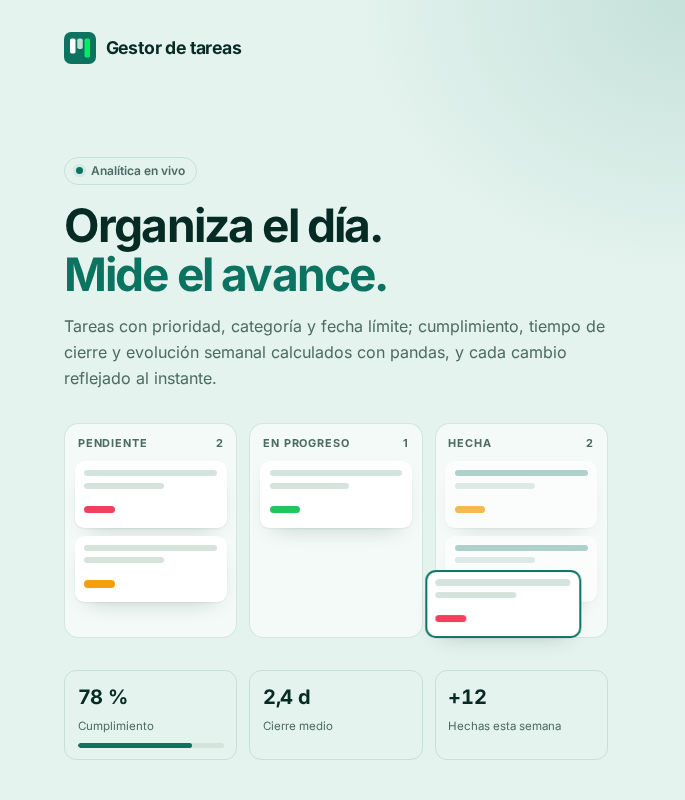

| | |
|---|---|
| **Producto** | Gestor de tareas |
| **Documento** | Manual de usuario |
| **Versión** | 2.0 · noviembre de 2026 |
| **Dirigido a** | Personas y equipos que organizan su trabajo, y analistas que convierten archivos de datos en informes |
| **Dirección** | [Gestor de tareas](https://taskflow-812302804238.us-east4.run.app/) |
| **Autor** | Luis F. A. |

## Contenido

1. [Portada](#1-portada)
2. [Introducción](#2-introducción)
3. [Objetivo](#3-objetivo)
4. [Alcance](#4-alcance)
5. [Acceso al sistema](#5-acceso-al-sistema)
6. [Pantalla principal](#6-pantalla-principal)
7. [Navegación](#7-navegación)
8. [Funcionalidades](#8-funcionalidades)
9. [Gestión de perfil](#9-gestión-de-perfil)
10. [Mensajes frecuentes](#10-mensajes-frecuentes)
11. [Preguntas frecuentes](#11-preguntas-frecuentes)
12. [Glosario](#12-glosario)

---

## 2. Introducción

El **Gestor de tareas** reúne dos herramientas en un mismo lugar:

- **Tareas:** anota lo que tienes por hacer con categoría, prioridad y fecha límite, márcalo al
  terminar y mira tu avance en un panel de analítica.
- **Datos:** sube un archivo (CSV, Excel o JSON) o genera un lote de ventas simulado y obtén un
  informe gerencial con indicadores, gráficos, tabla dinámica y medidas al estilo de Power BI.

Este manual explica cada pantalla, paso a paso y con imágenes.

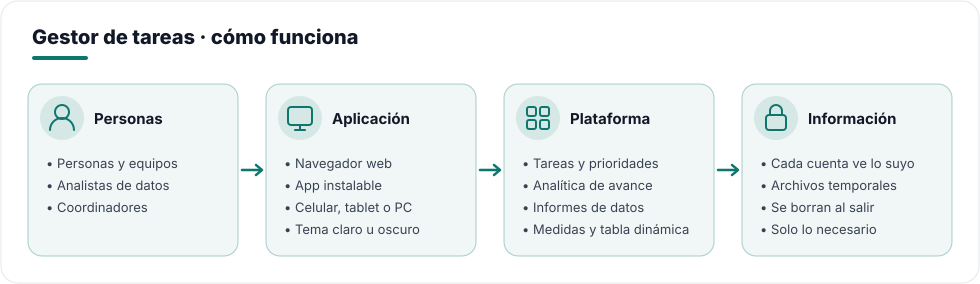

## 3. Objetivo

Que cualquier persona pueda, sin conocimientos técnicos:

- Crear su cuenta e ingresar de forma segura.
- Organizar sus tareas y seguir su cumplimiento.
- Convertir un archivo de datos en un informe con indicadores y gráficos.
- Explorar los datos con una tabla dinámica y medidas, y descargar o imprimir el resultado.

## 4. Alcance

**Incluye:** registro e ingreso con verificación en dos pasos, tareas con categoría, prioridad,
fecha y descripción, analítica de tareas, carga de archivos o generación de datos simulados, informe
gerencial, tabla dinámica, medidas DAX, origen y calidad de los datos, descarga en CSV e impresión
en PDF.

**No incluye:** tareas compartidas entre cuentas ni archivos permanentes: los archivos de datos se
borran al cerrar sesión.

**Qué necesitas:** un navegador actualizado, conexión a internet, un correo propio y una app
autenticadora en el celular (o acceso a tu correo para recibir códigos).

**Buenas prácticas:** no subas archivos con datos personales o confidenciales; usa los lotes
simulados para probar. Cada cuenta puede tener hasta 5 archivos de hasta 10 MB.

## 5. Acceso al sistema

### 5.1 Crear una cuenta

En la pantalla de ingreso pulsa **Crear una**.

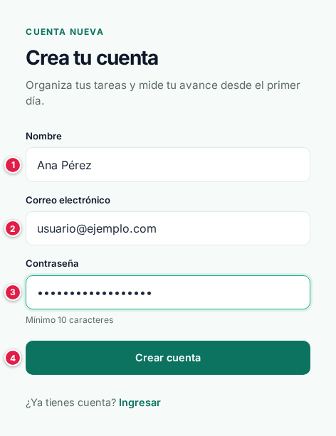

| # | Campo | Qué escribir |
|:-:|---|---|
| 1 | Nombre | Tu nombre |
| 2 | Correo electrónico | Un correo al que tengas acceso |
| 3 | Contraseña | Mínimo 10 caracteres |
| 4 | Crear cuenta | Crea tu cuenta y te lleva a configurar la verificación en dos pasos |

### 5.2 Iniciar sesión

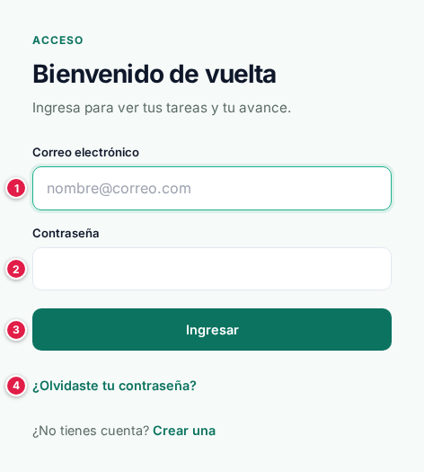

| # | Elemento | Qué hace |
|:-:|---|---|
| 1 | Correo electrónico | El correo de tu cuenta |
| 2 | Contraseña | Tu contraseña |
| 3 | Ingresar | Comprueba tus datos y pasa a la verificación en dos pasos |
| 4 | ¿Olvidaste tu contraseña? | Abre la recuperación de contraseña (5.4) |

Debajo, **Crear una** abre el registro (5.1).

### 5.3 Verificación en dos pasos

Cada ingreso pide, además de la contraseña, un código de 6 dígitos. La primera vez eliges cómo
recibirlo: con una **app autenticadora** (escaneas un código QR y la app muestra un código nuevo
cada 30 segundos, incluso sin internet) o con un **código por correo**.

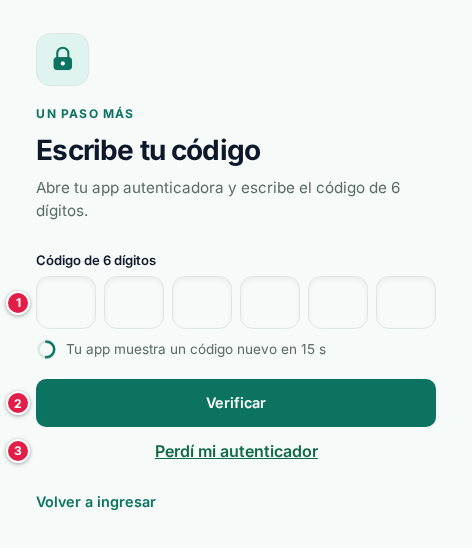

| # | Elemento | Qué hace |
|:-:|---|---|
| 1 | Código de 6 dígitos | El código que muestra tu app o que llegó a tu correo |
| 2 | Verificar | Confirma el código y abre la plataforma |
| 3 | Perdí mi autenticador | Si ya no tienes la app, te envía un código al correo de tu cuenta para configurar una app nueva |

### 5.4 Recuperar la contraseña

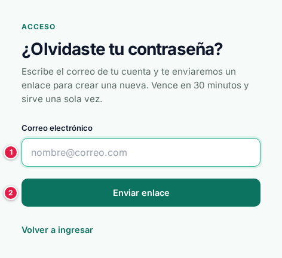

| # | Elemento | Qué hace |
|:-:|---|---|
| 1 | Correo | El correo de tu cuenta |
| 2 | Enviar enlace | Envía a ese correo un enlace para crear una contraseña nueva |

El mensaje es el mismo exista o no la cuenta. Abre el enlace del correo (vence en poco tiempo y
sirve una sola vez), escribe la contraseña nueva y vuelve a ingresar.

## 6. Pantalla principal

Al ingresar se abre **Tus tareas**.

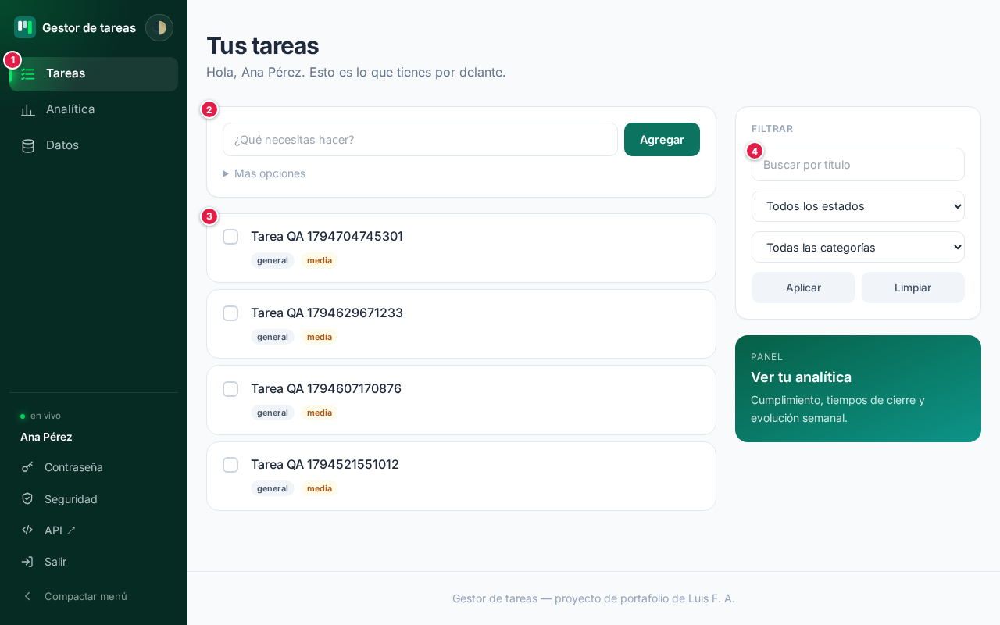

| # | Elemento | Qué hace |
|:-:|---|---|
| 1 | Menú lateral | Lleva a Tareas, Analítica y Datos (ver 7. Navegación) |
| 2 | Nueva tarea | Escribe la tarea y pulsa **Agregar** (8.1) |
| 3 | Tarea | Cada tarjeta muestra el título, la categoría, la prioridad y la fecha límite |
| 4 | Filtrar | Busca por título y filtra por estado o categoría |

A la derecha, **Ver tu analítica** abre el panel de avance (8.2).

## 7. Navegación

En el computador el menú está a la izquierda: **Tareas**, **Analítica** y **Datos**, y al pie
**Contraseña**, **Seguridad**, **API** (documentación para desarrolladores) y **Salir**.
**Compactar menú** lo reduce a íconos.

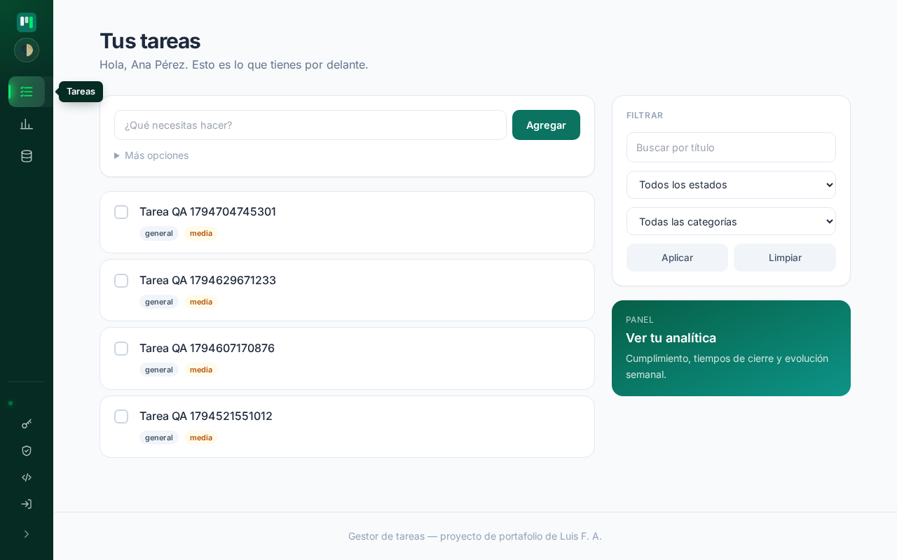

En la tablet en vertical y en el celular, el menú pasa a una barra inferior; **Más** abre una hoja
con las opciones de la cuenta. El botón ◐ cambia entre tema claro y oscuro.

| Tablet en vertical | Celular con la hoja "Más" |
|:-:|:-:|
| 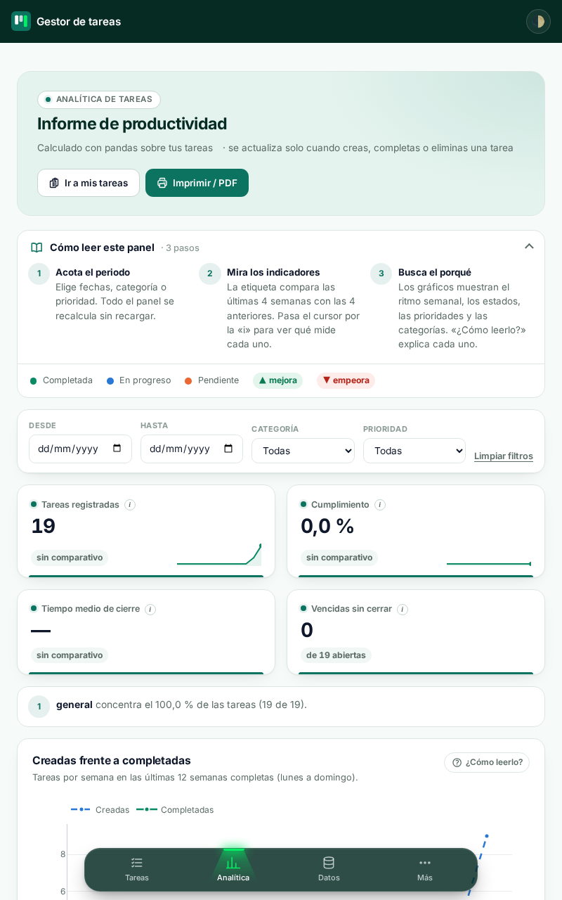 | 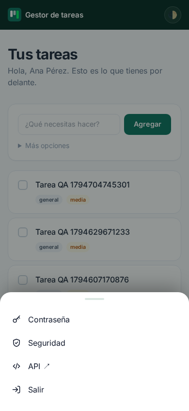 |

## 8. Funcionalidades

### 8.1 Crear: tareas y fuentes de datos

**Tarea.** Escribe el título y, si quieres, abre **Más opciones**.

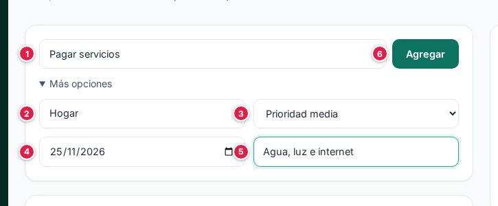

| # | Campo | Qué escribir |
|:-:|---|---|
| 1 | ¿Qué necesitas hacer? | El título de la tarea |
| 2 | Categoría | Por ejemplo Hogar, Trabajo o Estudio |
| 3 | Prioridad | Alta, media o baja |
| 4 | Fecha límite | Hasta cuándo tienes para hacerla |
| 5 | Descripción | Un detalle opcional |
| 6 | Agregar | Crea la tarea |

**Fuente de datos.** En **Datos** puedes generar un lote simulado o subir tu archivo.

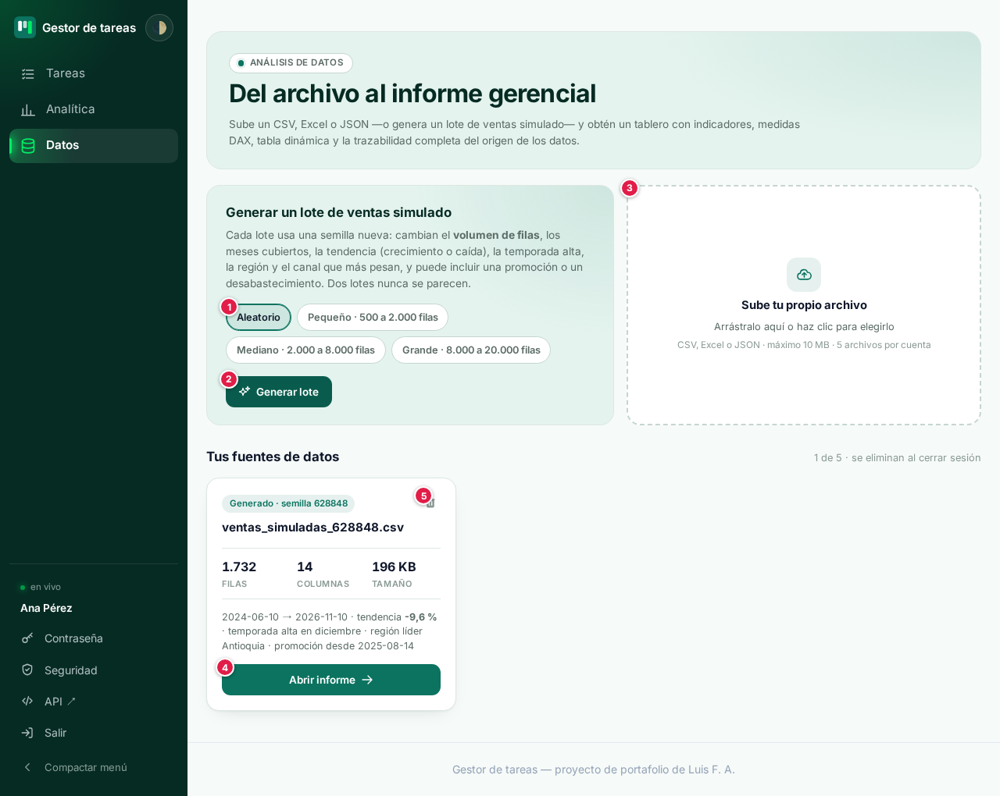

| # | Elemento | Qué hace |
|:-:|---|---|
| 1 | Volumen | Elige el tamaño del lote simulado (aleatorio, pequeño, mediano o grande) |
| 2 | Generar lote | Crea un lote de ventas simulado, distinto cada vez |
| 3 | Sube tu propio archivo | Arrastra o elige un CSV, Excel o JSON (hasta 10 MB) |
| 4 | Abrir informe | Abre el informe gerencial de esa fuente (8.2) |
| 5 | Borrar | Elimina la fuente de datos |

### 8.2 Consultar: analítica e informe

**Analítica de tareas.** Muestra tu cumplimiento, los tiempos de cierre y la evolución semanal.

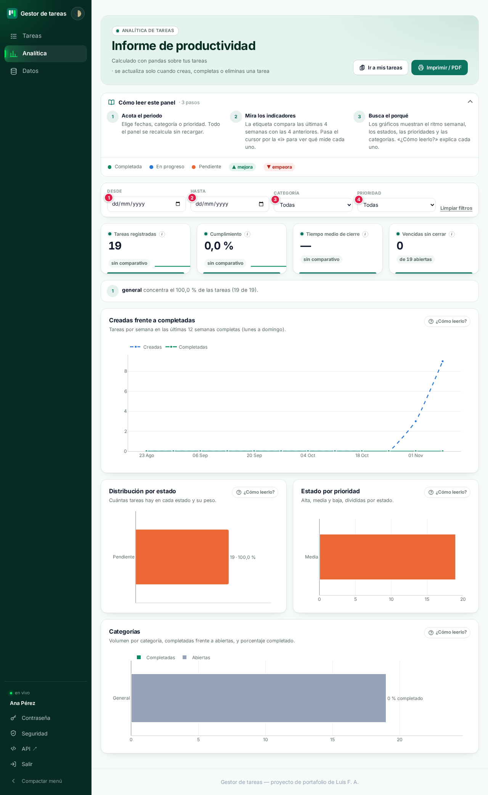

| # | Filtro | Qué hace |
|:-:|---|---|
| 1 | Desde | Fecha inicial del periodo |
| 2 | Hasta | Fecha final del periodo |
| 3 | Categoría | Limita el panel a una categoría |
| 4 | Prioridad | Limita el panel a una prioridad |

Las tarjetas comparan las últimas 4 semanas con las 4 anteriores (▲ mejora, ▼ empeora) y la «i»
explica qué mide cada una. **Imprimir / PDF** guarda el panel.

**Informe gerencial.** En **Datos → Abrir informe** se abre el informe de la fuente.

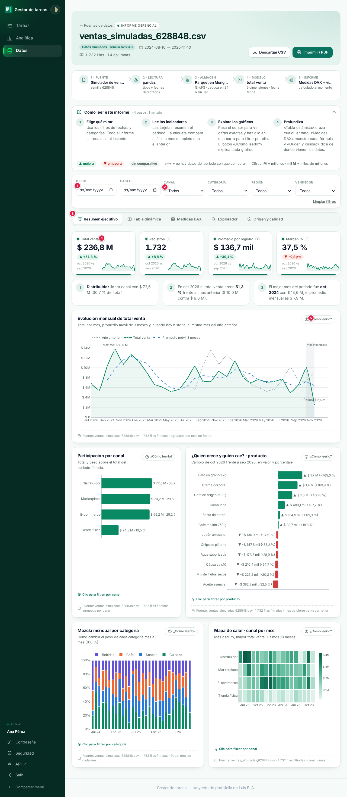

| # | Elemento | Qué hace |
|:-:|---|---|
| 1 | Periodo | Acota el informe por fechas |
| 2 | Filtros | Limita por canal, categoría, región o vendedor |
| 3 | Pestañas | Resumen ejecutivo, Tabla dinámica, Medidas DAX, Explorador y Origen y calidad |
| 4 | Indicadores | Total, registros, promedio y margen, comparados con el mes anterior |
| 5 | ¿Cómo leerlo? | Explica cada gráfico; al hacer clic en una barra se filtra el informe por ella |

### 8.3 Modificar: tareas y tabla dinámica

**Tareas.** Desde la lista cambias el estado o eliminas una tarea.

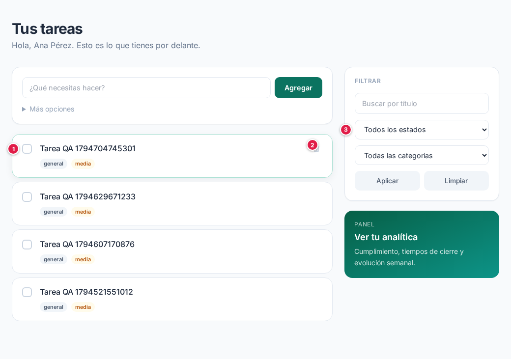

| # | Elemento | Qué hace |
|:-:|---|---|
| 1 | Casilla | Marca la tarea como completada (o la vuelve a pendiente) |
| 2 | Eliminar | Aparece al pasar el cursor; pide confirmación antes de borrar |
| 3 | Estado | Muestra solo las pendientes o las completadas |

**Tabla dinámica.** En la pestaña **Tabla dinámica** del informe armas tu propio cruce.

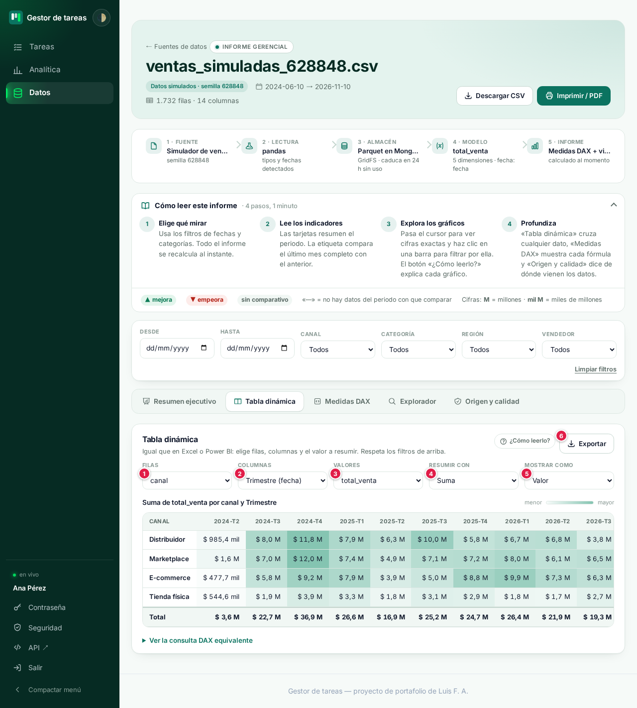

| # | Opción | Qué hace |
|:-:|---|---|
| 1 | Filas | La dimensión de las filas (por ejemplo, canal) |
| 2 | Columnas | La dimensión de las columnas (por ejemplo, trimestre) |
| 3 | Valores | La cifra que se resume |
| 4 | Resumir con | Suma, promedio, conteo, mínimo o máximo |
| 5 | Mostrar como | Valor o porcentaje |
| 6 | Exportar | Descarga la tabla |

### 8.4 Reportar: medidas, origen y descargas

**Medidas DAX.** Cada medida muestra su fórmula y su resultado; también puedes escribir una nueva.

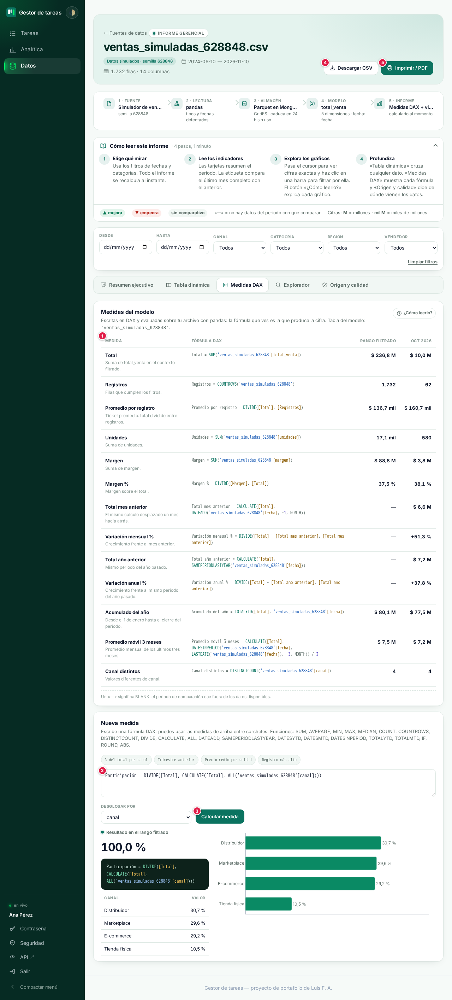

| # | Elemento | Qué hace |
|:-:|---|---|
| 1 | Medidas del modelo | Fórmula de cada medida y su valor en el periodo filtrado |
| 2 | Nueva medida | Escribe una fórmula DAX; los ejemplos de arriba la llenan con un clic |
| 3 | Calcular medida | Calcula y desglosa el resultado |
| 4 | Descargar CSV | Descarga los datos filtrados |
| 5 | Imprimir / PDF | Guarda el informe en PDF |

**Origen y calidad.** Dice de dónde vienen los datos y qué tan completos están.

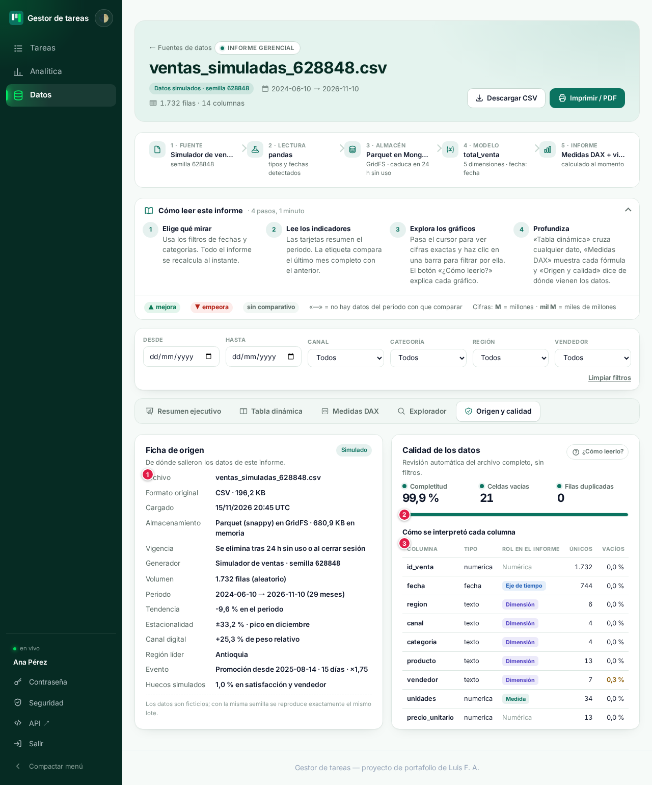

| # | Elemento | Qué muestra |
|:-:|---|---|
| 1 | Ficha | Nombre, origen, fecha de carga, filas y columnas |
| 2 | Calidad | Qué porcentaje de celdas está completo |
| 3 | Columnas | Tipo de dato y valores vacíos de cada columna |

## 9. Gestión de perfil

### 9.1 Cambiar contraseña

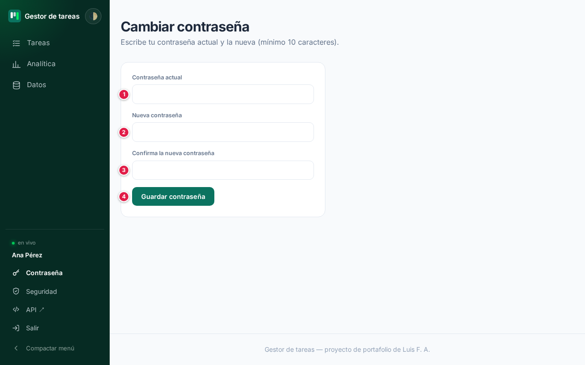

| # | Campo | Qué escribir |
|:-:|---|---|
| 1 | Contraseña actual | Tu contraseña de hoy |
| 2 | Nueva contraseña | Mínimo 10 caracteres |
| 3 | Confirma la nueva contraseña | La misma contraseña nueva |
| 4 | Guardar contraseña | Guarda el cambio; se cierran tus otras sesiones |

### 9.2 Seguridad

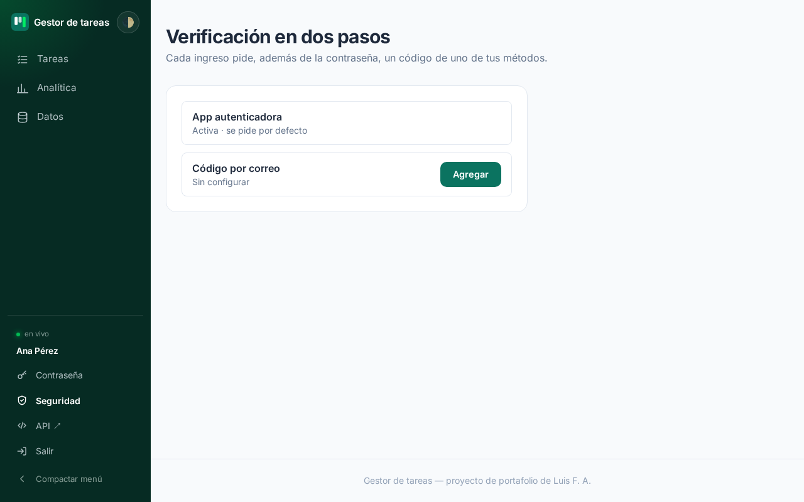

| Método | Qué puedes hacer |
|---|---|
| App autenticadora | Ver si está activa y si es el método que se pide por defecto |
| Código por correo | **Agregar** el método que te falta o **Pedir este por defecto** |

## 10. Mensajes frecuentes

| Mensaje | Qué significa | Qué hacer |
|---|---|---|
| Correo o contraseña incorrectos | Los datos no coinciden | Revísalos o usa **¿Olvidaste tu contraseña?** |
| Ese correo ya está registrado | Ya existe una cuenta con ese correo | Ingresa con él o recupera la contraseña |
| La contraseña debe tener al menos 10 caracteres | La contraseña es muy corta | Escribe una más larga |
| El código no es correcto o ya venció. | El código escrito no es el vigente | Escribe el código que muestra ahora la app |
| Pediste varios códigos seguidos. Espera unos minutos. | Se pidieron muchos códigos en poco tiempo | Espera unos minutos |
| ¿Eliminar esta tarea? | Confirmación antes de borrar | **Aceptar** la borra; **Cancelar** no hace nada |
| La función … no está soportada en este tablero. | La fórmula usa algo que el informe no calcula | Usa una de las funciones listadas en Nueva medida |
| Esta cuenta está suspendida | La cuenta no está habilitada | Escribe a soporte (ver 11) |
| Página no encontrada | La dirección que abriste no existe | Vuelve con el menú |
| Sin conexión | Tu equipo no tiene internet | La pantalla reintenta sola |

| Página no encontrada | Sin conexión |
|:-:|:-:|
| 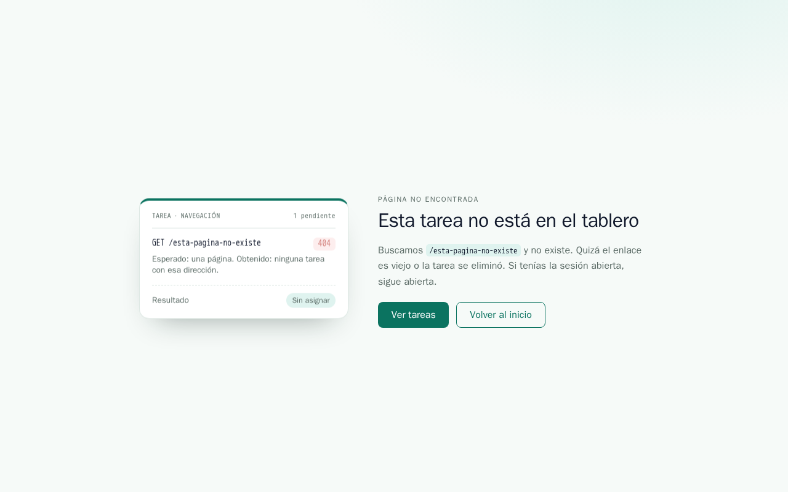 | 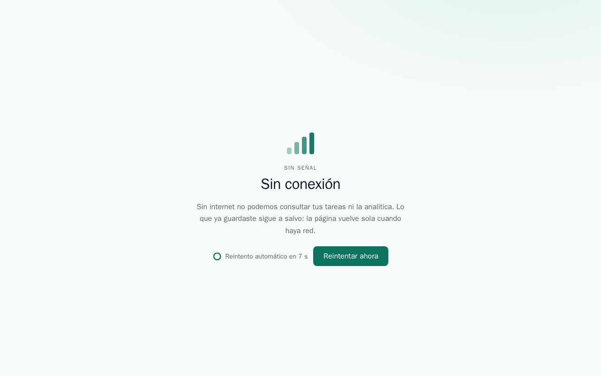 |

## 11. Preguntas frecuentes

**¿Por qué desaparecieron mis archivos de datos?** Se borran al cerrar sesión, a propósito: así no
quedan archivos guardados. Tus tareas sí se conservan.

**¿Por qué la primera carga tarda unos segundos?** El servicio se suspende cuando nadie lo usa y la
primera acción lo reactiva.

**¿Otra persona puede ver mis tareas o mis datos?** No. Cada cuenta ve lo suyo.

**¿Se puede instalar como aplicación?** Sí: en Chrome o Edge, **Instalar aplicación**; en iPhone,
Safari → **Compartir → Agregar a inicio**.

**¿Dónde pido ayuda o reporto un problema?** Telegram [@lfac6](https://t.me/lfac6), WhatsApp
[@carraian160](https://wa.me/carraian160) o [ariascluisf@hotmail.com](mailto:ariascluisf@hotmail.com).

## 12. Glosario

| Término | Qué significa |
|---|---|
| **App autenticadora** | Aplicación del celular que muestra un código nuevo cada 30 segundos para confirmar que eres tú |
| **Cumplimiento** | Porcentaje de tareas completadas |
| **DAX** | Lenguaje de fórmulas de Power BI y Excel para calcular medidas |
| **Lote simulado** | Datos de ventas de ejemplo que la plataforma genera para probar el informe |
| **Medida** | Una cifra calculada con una fórmula, como el total o el margen |
| **Tabla dinámica** | Resumen que cruza dos dimensiones (filas y columnas) y una cifra |
| **Verificación en dos pasos** | Además de la contraseña, se pide un código que solo tú puedes recibir |
