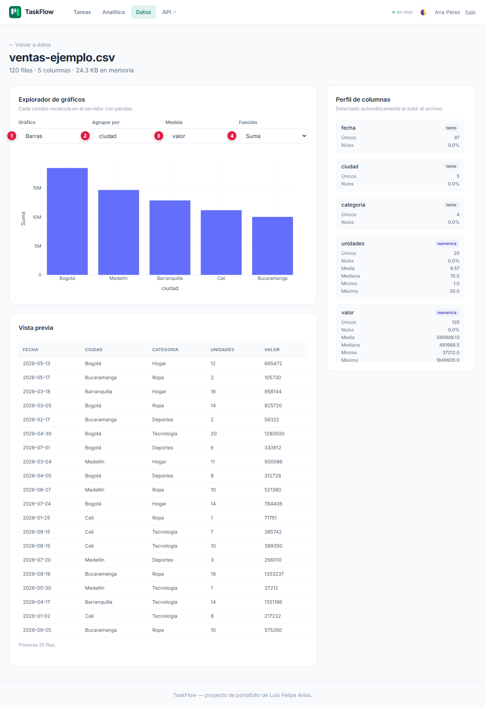

# 📘 Manual de usuario · TaskFlow

Guía para usar la plataforma paso a paso: qué significa cada campo, qué datos se ingresan y qué
protege la plataforma. Para la parte técnica vuelve al [README](../README.md).

**Demo:** [TaskFlow (Google Cloud Run)](https://taskflow-812302804238.us-central1.run.app/)

## Contenido

1. [En pocas palabras](#1-en-pocas-palabras)
2. [Antes de empezar](#2-antes-de-empezar)
3. [Paso a paso](#3-paso-a-paso)
4. [Qué información ingresas y dónde queda](#4-qué-información-ingresas-y-dónde-queda)
5. [Seguridad: qué se garantiza](#5-seguridad-qué-se-garantiza)
6. [Límites y recomendaciones](#6-límites-y-recomendaciones)
7. [Preguntas frecuentes](#7-preguntas-frecuentes)

---

## 1. En pocas palabras

Una lista de tareas con fechas, prioridades y categorías, más un panel que muestra cómo vas
(cumplimiento, tiempo de cierre, vencidas). También puedes subir un CSV, Excel o JSON: la app lo
describe sola y te deja graficarlo. Los números se actualizan en vivo, sin recargar.

## 2. Antes de empezar

- Solo necesitas un navegador.
- El indicador **● en vivo** (arriba a la derecha) muestra que la página recibe cambios en tiempo
  real.

## 3. Paso a paso

### 3.1 Inicio

Desde el inicio eliges **Crear cuenta** o **Ya tengo cuenta**.

### 3.2 Crear una cuenta

| # | Campo | Qué escribir | Reglas |
|:-:|---|---|---|
| 1 | Nombre | Cómo quieres que te salude la app | Entre 2 y 80 caracteres |
| 2 | Correo electrónico | El correo con el que vas a entrar | Formato válido y único |
| 3 | Contraseña | Tu contraseña | Entre **10 y 128 caracteres** |
| 4 | Crear cuenta | Botón | Crea la cuenta y te deja con la sesión iniciada |

### 3.3 Ingresar

| # | Campo | Qué escribir |
|:-:|---|---|
| 1 | Correo electrónico | El correo de tu cuenta |
| 2 | Contraseña | Tu contraseña |
| 3 | Ingresar | Abre **Tus tareas** |

La sesión se cierra tras **30 minutos sin actividad** y, en cualquier caso, a las **12 horas**.

### 3.4 Tus tareas

| # | Campo | Qué escribir |
|:-:|---|---|
| 1 | ¿Qué necesitas hacer? | Título de la tarea (3 a 140 caracteres) |
| 2 | Categoría | Texto libre para agrupar: Trabajo, Personal, Hogar… (en **Más opciones**) |
| 3 | Prioridad | Baja, media o alta |
| 4 | Fecha límite | Fecha de vencimiento |
| 5 | Descripción | Detalle opcional |
| 6 | Agregar | Agrega la tarea a la lista sin recargar |
| 7 | Buscar por título | Parte del título que buscas |
| 8 | Estado | Pendientes, En progreso o Completadas (la categoría se filtra en la lista de abajo) |

Pulsa **Aplicar** para filtrar o **Limpiar** para quitar los filtros. En cada tarea, la casilla la
marca como completada (o la devuelve a pendiente) y el botón de eliminar la borra.

### 3.5 Analítica

| # | Filtro | Qué hace |
|:-:|---|---|
| 1 | Desde | Fecha inicial del análisis |
| 2 | Hasta | Fecha final |
| 3 | Categoría | Limita a una categoría |
| 4 | Prioridad | Limita a una prioridad |

Debajo están los indicadores (tareas totales, cumplimiento, tiempo medio de cierre, vencidas sin
cerrar) y los gráficos **Creadas frente a completadas**, **Distribución por estado**, **Estado por
prioridad** y **Categorías**. Todo se recalcula al cambiar un filtro.

### 3.6 Datos: subir un archivo

| # | Campo | Qué escribir | Reglas |
|:-:|---|---|---|
| 1 | Selecciona un archivo | Un CSV, Excel (`.xlsx`) o JSON | Máximo **10 MB** y **500.000 filas**; el JSON debe ser una lista de objetos sin anidar |

Cada cuenta conserva hasta **5 archivos**, que se borran tras **24 horas sin uso** o al cerrar
sesión.

### 3.7 Explorar un archivo

| # | Campo | Qué elegir |
|:-:|---|---|
| 1 | Gráfico | Barras, líneas, área, torta, dispersión, caja o histograma |
| 2 | Agrupar por | La columna que forma las categorías (por ejemplo, ciudad) |
| 3 | Medida | La columna numérica que se calcula (por ejemplo, valor) |
| 4 | Función | Cantidad de registros, suma, promedio, máximo o mínimo |

A la derecha, el **Perfil de columnas** muestra el tipo de cada columna, sus valores únicos, nulos
y estadísticas. Abajo, la **Vista previa** muestra las primeras 20 filas.

### 3.8 API

**API ↗** abre la documentación interactiva de la API REST (`/docs`), con tu misma sesión.

## 4. Qué información ingresas y dónde queda

| Dato | Para qué se usa | Dónde se guarda | Quién lo ve |
|---|---|---|---|
| Nombre y correo | Identificar tu cuenta | MongoDB Atlas | Tú y el administrador |
| Contraseña | Iniciar sesión | MongoDB Atlas, **solo su huella** (bcrypt con pimienta) | Nadie: no se puede leer ni recuperar |
| Tareas | Tu lista y tu analítica | MongoDB Atlas, marcadas con tu cuenta | Tú y el administrador |
| Archivos que subes | Análisis | MongoDB (GridFS, convertidos a Parquet) | Solo tú; se borran a las 24 h sin uso o al salir |
| Sesión | Mantenerte conectado | Cookie en tu navegador | Firmada e invisible para JavaScript |

## 5. Seguridad: qué se garantiza

Comprobado en el código del proyecto (`backend/app/security.py`, `routers/web.py`,
`repositorio.py`, `datos.py`, `main.py`):

- **Contraseñas con bcrypt (coste 12) más una "pimienta" HMAC-SHA256** guardada fuera de la base:
  aunque se filtrara la base, las huellas no sirven sin esa clave. Las huellas antiguas se
  actualizan solas al siguiente ingreso.
- **Sesión con doble límite:** 30 minutos de inactividad (se renueva con el uso) y 12 horas como
  máximo absoluto. Cookie `HttpOnly` y `SameSite=Lax`.
- **Cada quien ve solo lo suyo:** la pertenencia de tareas y archivos se verifica dentro de la
  propia consulta a la base, también en la API.
- **Archivos acotados:** formato, tamaño (10 MB), filas (500.000) y cantidad (5) limitados, con
  caducidad automática.
- **Cabeceras de seguridad** en todas las respuestas: `X-Content-Type-Options: nosniff`,
  `X-Frame-Options: SAMEORIGIN` y `Referrer-Policy`.
- **Plantillas con escape automático** (Jinja2).
- **Secretos fuera del repositorio:** conexión a MongoDB, clave JWT y pimienta en variables de
  entorno de Cloud Run.

## 6. Límites y recomendaciones

Es una demo de portafolio:

- No hay recuperación de contraseña ni bloqueo por intentos fallidos.
- La cookie de sesión no lleva la marca `Secure` (el sitio se sirve igual solo por HTTPS en Cloud
  Run).
- **No subas archivos con datos personales o confidenciales**: usa datos de ejemplo.

## 7. Preguntas frecuentes

**¿Por qué desapareció mi archivo?** Los archivos se borran tras 24 horas sin uso o al cerrar
sesión. Vuelve a subirlo.

**¿Por qué el JSON no carga?** Debe ser una lista de objetos planos, como
`[{"ciudad": "Cali", "valor": 10}]`. Las estructuras anidadas se rechazan.

**¿Qué mide el "tiempo medio de cierre"?** El promedio entre la creación y la finalización de las
tareas completadas en el rango filtrado.
