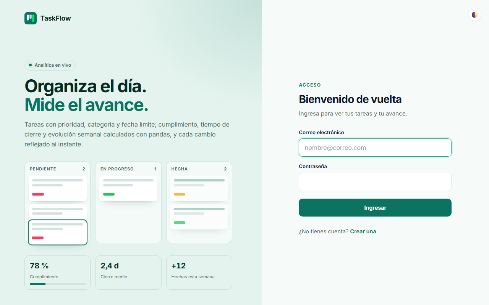
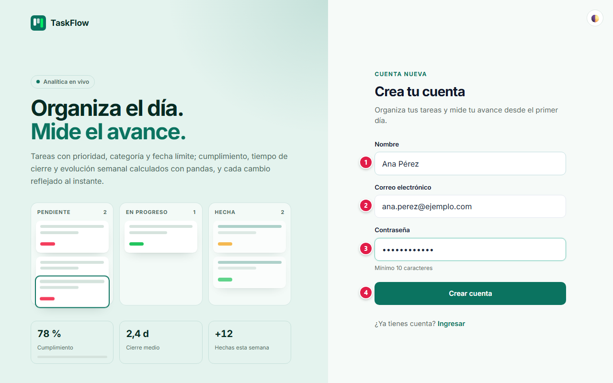
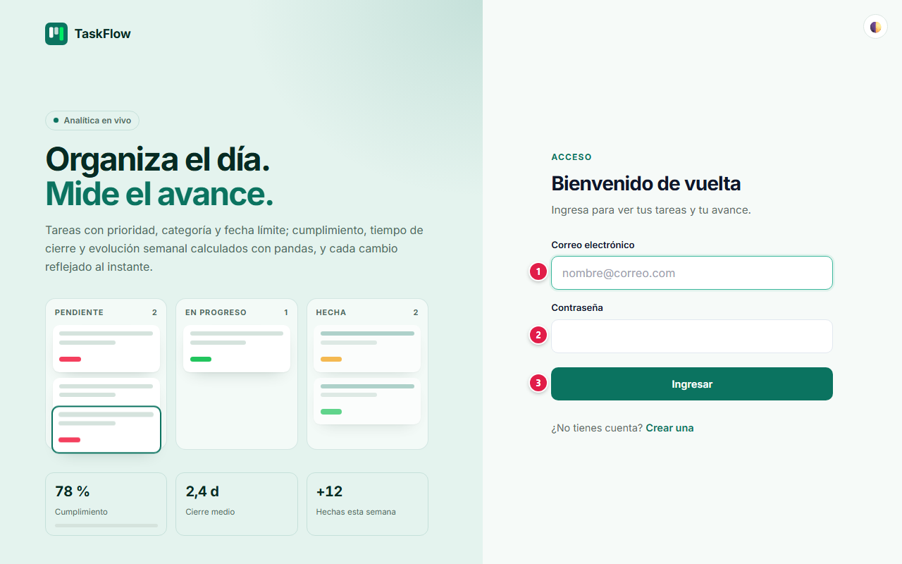
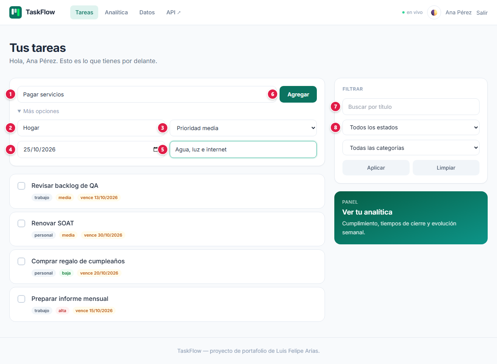
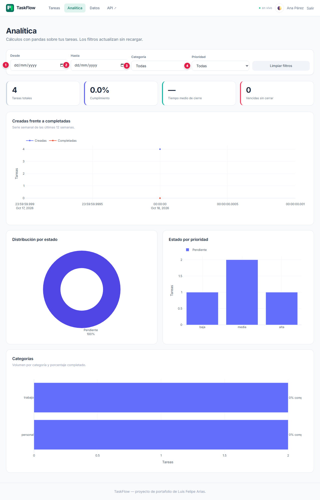
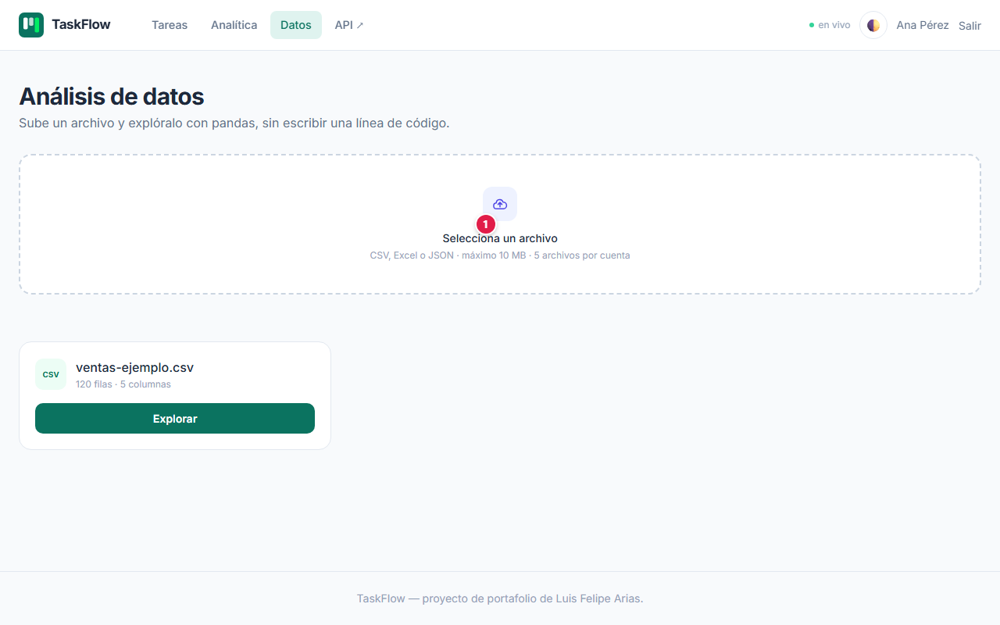
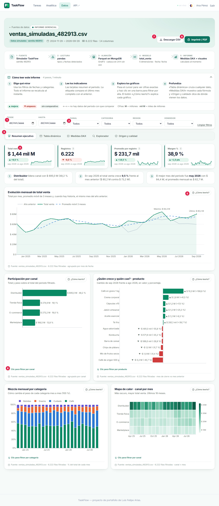
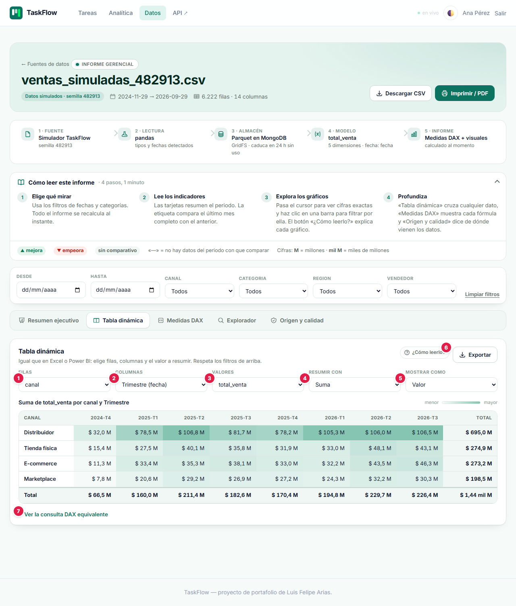
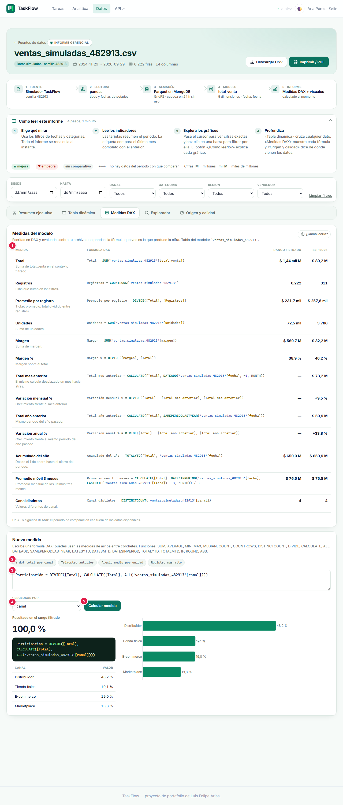
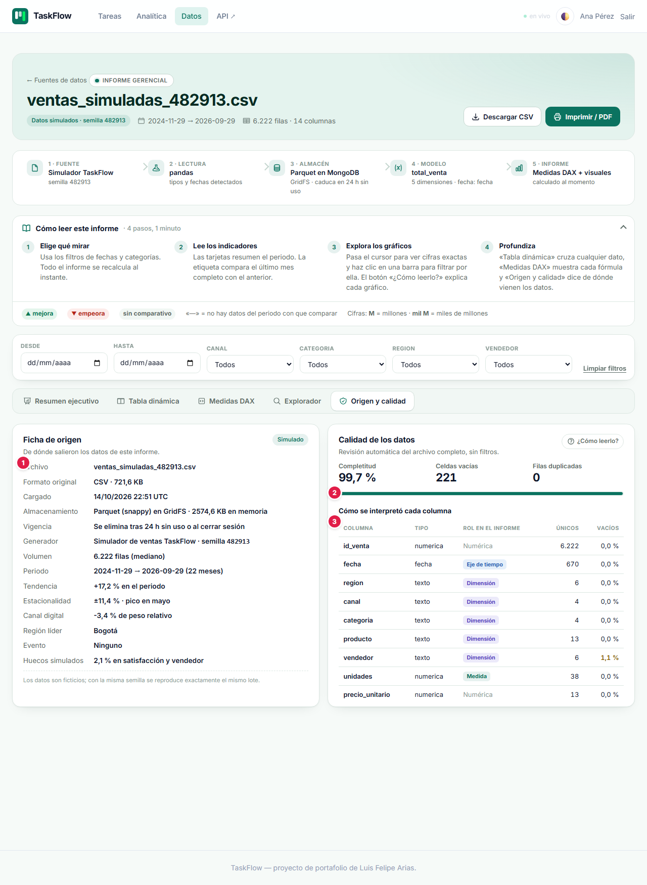

# 📘 Manual de usuario · TaskFlow

Guía para usar la plataforma paso a paso: qué significa cada campo, qué datos se ingresan y qué
protege la plataforma. Para la parte técnica vuelve al [README](../README.md).

**Demo:** [TaskFlow (Google Cloud Run)](https://taskflow-812302804238.us-east4.run.app/)

## Contenido

1. [Proyecto: objetivos y alcances](#1-proyecto-objetivos-y-alcances)
2. [Glosario](#2-glosario)
3. [Plataformas, base de datos y servicios](#3-plataformas-base-de-datos-y-servicios)
4. [Paso a paso](#4-paso-a-paso)
5. [Seguridad: tu información protegida](#5-seguridad-tu-información-protegida)
6. [Agradecimientos](#6-agradecimientos)

---

## 1. Proyecto: objetivos y alcances

### Objetivo

Una lista de tareas con fechas, prioridades y categorías, más un **informe de productividad** que
muestra cómo vas (cumplimiento, tiempo de cierre, vencidas). También puedes subir un CSV, Excel o
JSON —o generar un lote de ventas simulado— y la app lo convierte en un **informe gerencial**:
indicadores, gráficos explicados, medidas DAX, tabla dinámica y el origen de los datos. Los números
se actualizan en vivo, sin recargar.

### Alcance: qué necesitas y qué esperar

- Solo necesitas un navegador.
- El indicador **● en vivo** (arriba a la derecha) muestra que la página recibe cambios en tiempo
  real.

### Límites

Es una demo de portafolio:

- No hay recuperación de contraseña ni bloqueo por intentos fallidos.
- La cookie de sesión no lleva la marca `Secure` (el sitio se sirve igual solo por HTTPS en Cloud
  Run).
- **No subas archivos con datos personales o confidenciales**: usa datos de ejemplo.

## 2. Glosario

Palabras técnicas que aparecen en este manual, explicadas en lenguaje simple.

| Término | Qué significa |
|---|---|
| **Administrador** | Cuenta con permisos para gestionar usuarios y configuraciones de la aplicación. |
| **API** | Puerta de entrada de un programa para que otros programas le pidan o le envíen datos. |
| **Backend** | La parte de la aplicación que trabaja "detrás": procesa lo que envías y habla con la base de datos. |
| **Base de datos** | Lugar donde la aplicación guarda la información de forma ordenada y permanente. |
| **Cifrado / TLS / HTTPS** | Protección que codifica la información mientras viaja, para que nadie en el camino pueda leerla. |
| **Contraseña cifrada (hash)** | La contraseña no se guarda tal cual, sino como una "huella" de la que no se puede recuperar el texto original. |
| **Cookie** | Pequeño dato que el navegador guarda para recordar tu sesión en ese sitio. |
| **CSV** | Archivo de texto con datos en columnas, que se abre en Excel o Google Sheets. |
| **Excel / XLSX** | Formato de hoja de cálculo de Microsoft Excel. |
| **JWT** | Tipo de token firmado digitalmente: si alguien lo altera, el servidor lo rechaza. |
| **Modo mantenimiento** | Pantalla que aparece cuando el servicio o su base de datos no responden; se recupera sola cuando vuelven. |
| **Navegador** | Programa con el que abres páginas web: Chrome, Edge, Firefox, Safari. |
| **Nube** | Servidores de una empresa (Amazon, Microsoft, Google, Oracle…) donde la aplicación funciona sin depender de un computador propio. |
| **Pandas / análisis de datos** | Herramienta de Python para leer, limpiar y resumir tablas de datos. |
| **PDF** | Formato de documento que se ve igual en cualquier equipo. |
| **Rate limit (límite de intentos)** | Tope de intentos en poco tiempo, para frenar a quien intenta adivinar contraseñas. |
| **Recurrencia (RRULE)** | Regla que indica cada cuánto se repite un evento (diario, semanal, días laborables…). |
| **REST** | Forma estándar de organizar una API usando direcciones web y métodos como GET o POST. |
| **Rol** | Tipo de cuenta que define qué puede hacer cada persona (por ejemplo, usuario o administrador). |
| **Sesión** | El tiempo en que la aplicación te reconoce después de iniciar sesión, sin pedirte la contraseña de nuevo. |
| **Variables de entorno / secretos** | Claves y contraseñas internas de la aplicación, guardadas fuera del código para que no queden expuestas. |

## 3. Plataformas, base de datos y servicios

Qué servicio de nube, base de datos o API usa el proyecto y para qué sirve cada uno.

| Plataforma | Tipo | Qué hace en el proyecto |
|---|---|---|
|  | Nube | Corre la app FastAPI: páginas Jinja2 + HTMX, API REST y canal de eventos en vivo. |
|  | Base de datos | MongoDB Atlas guarda usuarios, tareas y archivos (estos últimos en GridFS). Es el único servicio externo: no requiere otra cuenta ni clave de API. |
|  | Pruebas automatizadas | Prueba la demo automáticamente dos veces al día y publica la evidencia. |

## 4. Paso a paso

### 4.1 Inicio

Desde el inicio eliges **Crear cuenta** o **Ya tengo cuenta**.

### 4.2 Crear una cuenta

| # | Campo | Qué escribir | Reglas |
|:-:|---|---|---|
| 1 | Nombre | Cómo quieres que te salude la app | Entre 2 y 80 caracteres |
| 2 | Correo electrónico | El correo con el que vas a entrar | Formato válido y único |
| 3 | Contraseña | Tu contraseña | Entre **10 y 128 caracteres** |
| 4 | Crear cuenta | Botón | Crea la cuenta y te lleva a elegir tu verificación en dos pasos |

### 4.3 Ingresar

| # | Campo | Qué escribir |
|:-:|---|---|
| 1 | Correo electrónico | El correo de tu cuenta |
| 2 | Contraseña | Tu contraseña |
| 3 | Ingresar | Pide el código de tu verificación en dos pasos |

Después de la contraseña escribe el **código de 6 dígitos** de tu método (ver 4.3.3) y pulsa
**Verificar**. Si tienes los dos métodos activos, puedes cambiar al otro desde la misma pantalla.

La sesión se cierra tras **30 minutos sin actividad** y, en cualquier caso, a las **12 horas**.

### 4.3.1 Olvidé mi contraseña

En **Ingresar**, pulsa **¿Olvidaste tu contraseña?** y escribe tu correo. Si la cuenta existe y está
activa, te llega un enlace para crear una contraseña nueva (mínimo 10 caracteres). El enlace vence en
30 minutos y sirve una sola vez. La pantalla muestra el mismo mensaje exista o no la cuenta.

### 4.3.2 Cambiar la contraseña

Con la sesión iniciada, abre **Contraseña** en el menú, escribe la actual y la nueva dos veces.

### 4.3.3 Verificación en dos pasos (obligatoria)

Cada ingreso pide, además de la contraseña, un código. La primera vez que ingresas (o al crear la
cuenta) eliges cómo recibirlo:

| Método | Cómo funciona |
|---|---|
| **App autenticadora** (recomendado) | Escaneas un código QR con Google Authenticator, Microsoft Authenticator u otra app; desde ese momento la app muestra un código nuevo cada 30 segundos, incluso sin internet. Si no puedes escanear, escribe la clave que aparece bajo el QR. |
| **Código por correo** | Cada vez que ingresas te llega un código de 6 dígitos que vence en 10 minutos y sirve una sola vez. |

Confirma el método escribiendo el primer código. Desde **Seguridad** (menú superior) puedes
**agregar el método que no elegiste** y escoger cuál se pide **por defecto**; tener los dos te
permite entrar aunque no tengas el teléfono a mano.

### 4.4 Tus tareas

| # | Campo | Qué escribir |
|:-:|---|---|
| 1 | ¿Qué necesitas hacer? | Título de la tarea (3 a 140 caracteres) |
| 2 | Categoría | Texto libre para agrupar: Trabajo, Personal, Hogar… (en **Más opciones**) |
| 3 | Prioridad | Baja, media o alta |
| 4 | Fecha límite | Fecha de vencimiento |
| 5 | Descripción | Detalle opcional |
| 6 | Agregar | Agrega la tarea a la lista sin recargar |
| 7 | Buscar por título | Parte del título que buscas |
| 8 | Estado | Pendientes, En progreso o Completadas (la categoría se filtra en la lista de abajo) |

Pulsa **Aplicar** para filtrar o **Limpiar** para quitar los filtros. En cada tarea, la casilla la
marca como completada (o la devuelve a pendiente) y el botón de eliminar la borra.

### 4.5 Analítica: informe de productividad

| # | Filtro | Qué hace |
|:-:|---|---|
| 1 | Desde | Fecha inicial del análisis |
| 2 | Hasta | Fecha final |
| 3 | Categoría | Limita a una categoría |
| 4 | Prioridad | Limita a una prioridad |

Todo se recalcula al cambiar un filtro, y también solo cuando creas, completas o eliminas una
tarea. **Limpiar filtros** vuelve a mostrarlo todo.

**Cómo leer este panel** (arriba, plegable) explica el panel en tres pasos y muestra la leyenda de
colores: verde = completada, azul = en progreso, naranja = pendiente.

**Indicadores.** Pasa el cursor por la **i** de cada tarjeta para ver qué mide.

| Indicador | Qué significa | Etiqueta debajo |
|---|---|---|
| Tareas registradas | Tareas que cumplen los filtros | Creadas en las últimas 4 semanas frente a las 4 anteriores |
| Cumplimiento | Porcentaje de tareas completadas | Cambio en puntos; verde ▲ si mejora, rojo ▼ si empeora |
| Tiempo medio de cierre | Promedio entre creación y finalización | Verde si baja (se cierra más rápido) |
| Vencidas sin cerrar | Abiertas con la fecha límite vencida | Cuántas abiertas hay en total |

Debajo, tres **hallazgos** resumen el panel en frases (por ejemplo, la categoría que concentra
más tareas o la de menor cumplimiento).

**Gráficos.** Cada uno tiene el botón **¿Cómo leerlo?**, que explica qué muestra, cómo leerlo y
qué pregunta responde.

| Gráfico | Qué responde |
|---|---|
| Creadas frente a completadas | ¿Estoy al día o se acumula trabajo? Semanas completas, de lunes a domingo |
| Distribución por estado | ¿Cuánto está terminado, en marcha o sin empezar? |
| Estado por prioridad | ¿Estoy atendiendo primero lo importante? |
| Categorías | ¿Dónde se concentra el trabajo y qué área va más atrasada? |

**Imprimir / PDF** genera el informe sin los controles.

### 4.6 Datos: elegir una fuente

| # | Elemento | Qué hacer | Reglas |
|:-:|---|---|---|
| 1 | Volumen | Elige **Aleatorio**, **Pequeño** (500 a 2.000 filas), **Mediano** (2.000 a 8.000) o **Grande** (8.000 a 20.000) | Solo para lotes simulados |
| 2 | Generar lote | Crea un lote de ventas simulado | Cada clic usa una semilla nueva: cambian el volumen, el periodo, la tendencia, la temporada, la región y el canal líderes, y puede haber una promoción o un desabastecimiento |
| 3 | Sube tu propio archivo | Arrastra un CSV, Excel (`.xlsx`) o JSON, o haz clic para elegirlo | Máximo **10 MB** y **500.000 filas**; el JSON debe ser una lista de objetos sin anidar |
| 4 | Abrir informe | Abre el informe gerencial de esa fuente | — |
| 5 | Eliminar | Borra la fuente (pide confirmación) | — |

Cada tarjeta indica si la fuente es un **archivo subido** o un lote **generado** (con su semilla),
sus filas, columnas y tamaño. En los lotes generados se resume el escenario: periodo, tendencia,
temporada alta, región líder y evento.

Cada cuenta conserva hasta **5 fuentes**, que se borran tras **24 horas sin uso** o al cerrar
sesión.

### 4.7 Informe gerencial: resumen ejecutivo

Arriba están el nombre de la fuente, su periodo y el **recorrido de los datos** en cinco pasos:
fuente → lectura → almacén → modelo → informe. Debajo, **Cómo leer este informe** lo explica en
cuatro pasos y aclara los símbolos (▲ mejora, ▼ empeora, «—» sin dato para comparar, **M** =
millones, **mil M** = miles de millones).

| # | Elemento | Qué hace |
|:-:|---|---|
| 1 | Desde / Hasta | Acota el periodo de todo el informe |
| 2 | Segmentadores | Filtran por categoría (por ejemplo, canal o región). Aplican a todas las pestañas |
| 3 | Pestañas | Resumen ejecutivo, Tabla dinámica, Medidas DAX, Explorador y Origen y calidad |
| 4 | **i** de cada indicador | Explica en una frase qué mide |
| 5 | ¿Cómo leerlo? | Explica el gráfico: qué muestra, cómo leerlo y qué pregunta responde |
| 6 | Clic para filtrar | Un clic en una barra, una celda o un color filtra todo el informe por ese valor; aparece como un chip con **×** para quitarlo |
| 7 | Descargar CSV | Baja la fuente completa, lista para Excel o Power BI |
| 8 | Imprimir / PDF | Genera el informe sin los controles |

Los **indicadores** muestran el total del periodo filtrado y una etiqueta que compara el último
mes completo con el anterior. Debajo, tres **hallazgos** resumen lo más importante en frases.

| Gráfico | Qué responde |
|---|---|
| Evolución mensual | ¿Crecemos, estamos estancados o caemos? Incluye promedio móvil de 3 meses y, si hay historia, el año anterior |
| Participación | ¿De dónde sale la mayor parte del negocio? |
| ¿Quién crece y quién cae? | ¿Qué explica la variación del mes? Verde ▲ sube, rojo ▼ baja |
| Mezcla mensual | ¿Está cambiando la forma en que vendemos? |
| Mapa de calor | ¿Hay meses fuertes o débiles que se repiten? |

Al pie de cada gráfico se indica la **fuente**: el archivo, las filas filtradas y cómo se agrupó.

### 4.8 Tabla dinámica

| # | Campo | Qué elegir |
|:-:|---|---|
| 1 | Filas | La dimensión de las filas, o Año, Trimestre o Mes de la fecha |
| 2 | Columnas | La dimensión de las columnas, o ninguna |
| 3 | Valores | La columna numérica a resumir, o contar registros |
| 4 | Resumir con | Suma, promedio, conteo, distintos, máximo o mínimo |
| 5 | Mostrar como | Valor, % del total general, % de la fila o % de la columna |
| 6 | Exportar | Descarga la tabla en CSV, con los filtros aplicados |
| 7 | Ver la consulta DAX equivalente | Muestra la misma tabla escrita como consulta DAX |

La última fila y la última columna son los **totales**. Cuanto más verde la celda, mayor el valor.

### 4.9 Medidas DAX

| # | Elemento | Qué hace |
|:-:|---|---|
| 1 | Medidas del modelo | Cada medida con su fórmula DAX y su valor en el **rango filtrado** y en el **último mes completo** |
| 2 | Ejemplos | Botones que escriben una fórmula de ejemplo en el editor |
| 3 | Fórmula | Escribe tu medida, por ejemplo `Participación = DIVIDE([Total], CALCULATE([Total], ALL('tabla'[canal])))` |
| 4 | Desglosar por | Calcula la medida para cada valor de una dimensión |
| 5 | Calcular medida | Muestra el resultado, la fórmula, la tabla del desglose y su gráfico |

Puedes usar las medidas del modelo entre corchetes (`[Total]`, `[Registros]`…). Funciones
disponibles: SUM, AVERAGE, MIN, MAX, MEDIAN, COUNT, COUNTROWS, DISTINCTCOUNT, DIVIDE, CALCULATE,
ALL, DATEADD, SAMEPERIODLASTYEAR, DATESYTD, DATESMTD, DATESINPERIOD, TOTALYTD, TOTALMTD, IF,
ROUND y ABS. Si la fórmula tiene un error, se muestra un mensaje que dice qué corregir.

### 4.10 Origen y calidad

| # | Elemento | Qué muestra |
|:-:|---|---|
| 1 | Ficha de origen | Archivo, formato, tamaño, fecha de carga, almacenamiento y vigencia. En los lotes simulados, además: semilla, volumen, periodo, tendencia, estacionalidad, región líder y evento |
| 2 | Completitud | Porcentaje de celdas con dato, celdas vacías y filas duplicadas |
| 3 | Cómo se interpretó cada columna | El rol que el informe le dio a cada columna: medida principal, eje de tiempo, dimensión o medida |

### 4.11 Explorador

La pestaña **Explorador** permite un gráfico libre:

| Campo | Qué elegir |
|---|---|
| Gráfico | Barras, líneas, área, torta, dispersión, caja o histograma |
| Agrupar por | La columna que forma las categorías |
| Medida | La columna numérica que se calcula |
| Función | Cantidad de registros, suma, promedio, máximo o mínimo |

Debajo, la **Vista previa** muestra las primeras 20 filas de la fuente.

### 4.12 API

**API ↗** abre la documentación interactiva de la API REST (`/docs`), con tu misma sesión.
Para ingresar por la API, `POST /api/auth/login` exige además el campo `codigo` (el de tu app o
del correo; si tu método es el correo y no lo envías, la API te manda uno).

### 4.13 Preguntas frecuentes

**¿Por qué desapareció mi archivo?** Los archivos se borran tras 24 horas sin uso o al cerrar
sesión. Vuelve a subirlo.

**¿Por qué el JSON no carga?** Debe ser una lista de objetos planos, como
`[{"ciudad": "Cali", "valor": 10}]`. Las estructuras anidadas se rechazan.

**¿Qué mide el "tiempo medio de cierre"?** El promedio entre la creación y la finalización de las
tareas completadas en el rango filtrado.

**¿Por qué cada lote generado es distinto?** Cada clic en **Generar lote** usa una semilla nueva que
define el volumen, el periodo y el escenario de negocio. La semilla queda en **Origen y calidad**:
con la misma semilla se obtiene exactamente el mismo lote.

**¿Qué significa "—" en una medida?** Que no hay datos para comparar, por ejemplo el año anterior de
un archivo que cubre menos de un año. Se deja vacío para no comparar contra un periodo a medias.

**¿Por qué no se compara el mes en curso?** Si el archivo termina a mitad de mes, se compara el
último mes completo: un mes a medias haría parecer que todo cayó. Por lo mismo, el informe de
productividad muestra solo semanas completas.

**¿Es Power BI?** No. Es un intérprete del DAX más usado en informes gerenciales, calculado con
pandas sobre tu archivo. Las fórmulas se pueden copiar a Power BI.

**¿Cómo quito un filtro que puse con un clic en un gráfico?** Pulsa la **×** del chip que aparece en
la barra de filtros, o **Limpiar filtros**.

**¿Qué significa la pantalla "Estamos en mantenimiento"?** El servicio o su base de datos no están respondiendo en ese momento. No se perdió nada: tus tareas y tus datos siguen guardados, y ninguna acción quedó a medias (si no viste la confirmación, no se guardó). La pantalla se actualiza sola y vuelve a la normalidad apenas el servicio responda; también puedes reintentar más tarde.

## 5. Seguridad: tu información protegida

Tu confianza es lo primero: la plataforma solo pide los datos necesarios para funcionar, los protege y no los comparte con terceros. Esto es lo que se guarda y cómo se protege.

### Qué datos se guardan y dónde

| Dato | Para qué se usa | Dónde se guarda | Quién lo ve |
|---|---|---|---|
| Nombre y correo | Identificar tu cuenta | MongoDB Atlas | Tú y el administrador |
| Contraseña | Iniciar sesión | MongoDB Atlas, **solo su huella** (bcrypt con pimienta) | Nadie: no se puede leer ni recuperar |
| Tareas | Tu lista y tu analítica | MongoDB Atlas, marcadas con tu cuenta | Tú y el administrador |
| Archivos que subes | Análisis | MongoDB (GridFS, convertidos a Parquet) | Solo tú; se borran a las 24 h sin uso o al salir |
| Lotes simulados | Probar el informe sin datos propios | Igual que los archivos, con su semilla y escenario | Solo tú; los datos son ficticios |
| Fórmulas DAX que escribes | Calcular una medida | No se guardan: se evalúan al momento | Solo tú |
| Sesión | Mantenerte conectado | Cookie en tu navegador | Firmada e invisible para JavaScript |
| Verificación en dos pasos | Confirmar que eres tú al ingresar | MongoDB Atlas: clave de la app **cifrada** (AES-GCM) y código del correo **solo como huella** | Nadie: no se puede leer desde la base |

### Cómo se protege tu información

Comprobado en el código del proyecto (`backend/app/security.py`, `routers/web.py`,
`repositorio.py`, `datos.py`, `main.py`):

- **Contraseñas con bcrypt (coste 12) más una "pimienta" HMAC-SHA256** guardada fuera de la base:
  aunque se filtrara la base, las huellas no sirven sin esa clave. Las huellas antiguas se
  actualizan solas al siguiente ingreso.
- **Verificación en dos pasos obligatoria** con app autenticadora (TOTP) o código por correo:
  la clave de la app se guarda cifrada, un código no se acepta dos veces, 5 códigos errados de la
  app la bloquean 15 minutos, y el código del correo vence en 10 minutos, admite 5 intentos y se
  pueden pedir 3 cada 10 minutos.
- **Sesión con doble límite:** 30 minutos de inactividad (se renueva con el uso) y 12 horas como
  máximo absoluto. Cookie `HttpOnly` y `SameSite=Lax`.
- **Cada quien ve solo lo suyo:** la pertenencia de tareas y archivos se verifica dentro de la
  propia consulta a la base, también en la API.
- **Archivos acotados:** formato, tamaño (10 MB), filas (500.000) y cantidad (5) limitados, con
  caducidad automática.
- **Cabeceras de seguridad** en todas las respuestas: `X-Content-Type-Options: nosniff`,
  `X-Frame-Options: SAMEORIGIN` y `Referrer-Policy`.
- **Plantillas con escape automático** (Jinja2). Los nombres que vienen de tus archivos también se
  escapan en los hallazgos escritos.
- **Las fórmulas DAX no ejecutan código:** un intérprete propio solo admite las funciones de la
  lista; el texto nunca se pasa a `eval`.
- **Secretos fuera del repositorio:** conexión a MongoDB, clave JWT y pimienta en variables de
  entorno de Cloud Run.
- **Runtime con parches de seguridad:** la imagen fija Python 3.12.15 y certifi 2026.10.19 o
  posterior, que deja de confiar en los certificados intermedios comprometidos de eMudhra. La
  imagen tampoco confía en las raíces emSign ni «AAA Certificate Services» que firmaron esos
  intermedios comprometidos de eMudhra (la misma mitigación que publicó Red Hat). Las dependencias
  se auditan (npm audit, pip-audit o dotnet list package --vulnerable) y quedaron sin
  vulnerabilidades conocidas altas ni críticas.

## 6. Agradecimientos

A mi familia, por su apoyo incondicional, su paciencia y por creer en cada proyecto incluso cuando apenas era una idea. Este trabajo también es de ustedes.

Y a ti, que usas esta plataforma: cada prueba, comentario y sugerencia ayuda a que siga mejorando.
